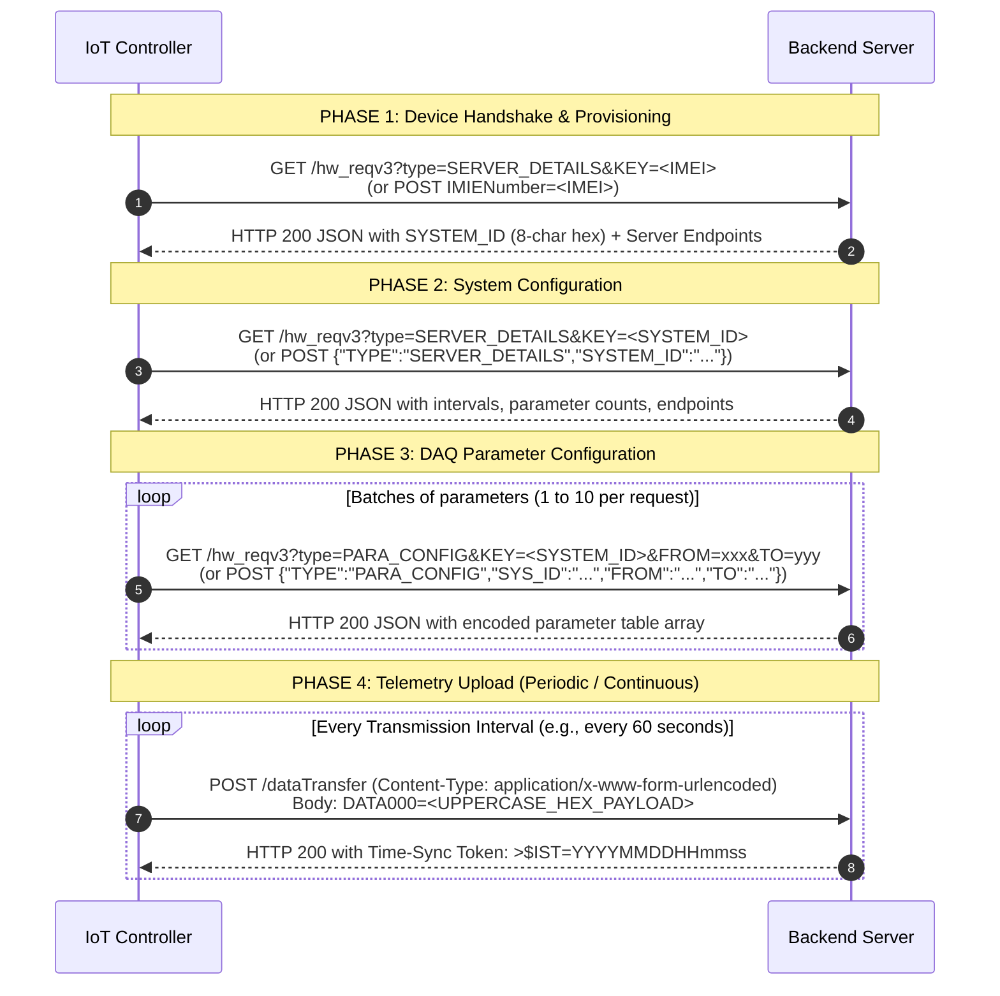

# IoT Controller — Backend Server Implementation Guide

This document is a complete, self-contained engineering specification for building a backend server (Node.js, Python, Go, C#/.NET, Java, etc.) that interfaces with industrial IoT controllers based on Renesas RL78/G13 hardware.

---

## 1. System Architecture & Communication Flow

The device communicates over **HTTP/1.1** via Cellular 4G (Quectel EC200U), Wi-Fi (Quectel FCM360W), or Ethernet (WIZnet W5500).



---

## 2. API Endpoints Specification

All routes must be served on the server's configured host and port (default HTTP port `80` or `8080`).

---

### Endpoint 1: Device Registration (`GET /hw_reqv3` or Form `POST`)

Called by the device on first boot or when its registration flag is cleared.

* **Method:** `GET` (or `POST`)
* **Path:** `/hw_reqv3` (or `/reg.aspx` / `/unitconfigpost.aspx`)
* **Query Parameters (GET):**
  * `type`: `"SERVER_DETAILS"`
  * `KEY`: Device IMEI string (up to 15 numeric digits, e.g., `865510081833552`)
* **Form Parameters (Legacy POST):**
  * `IMIENumber`: Device IMEI string

#### Expected Server Response (HTTP 200 JSON):
The backend looks up or creates the device entry using the IMEI and returns an 8-character Little-Endian hexadecimal `SYSTEM_ID`:

```json
{
  "SYSTEM_ID": "5E0D0000",
  "SERVER_ADD": "config.example.com",
  "SERVER_PORT": "80",
  "SERVER_PATH": "/",
  "SER_APP_DATA": "dataTransfer",
  "NO_OF_PARAMETERS": "00A",
  "DATA_ACQ_MINUTES": "01",
  "DATA_TRANS_MINUTES": "05"
}
```

> [!IMPORTANT]
> `SYSTEM_ID` must be an **8-character little-endian hex string** of a 32-bit integer (e.g. integer `3422` $\to$ `0x00000D5E` $\to$ little-endian byte order: `5E 0D 00 00` $\to$ `"5E0D0000"`).

---

### Endpoint 2: System Configuration (`GET /hw_reqv3` or JSON `POST`)

Called by the device after registration to obtain operational intervals and endpoint routes.

* **Method:** `GET` (or `POST`)
* **Path:** `/hw_reqv3` (or configured `SERVER_APP_SYS_CONFIG`)
* **Query Parameters (GET):**
  * `type`: `"SERVER_DETAILS"`
  * `KEY`: The device's 8-character hex `SYSTEM_ID` (e.g., `5E0D0000`)
* **JSON Body (POST):**
  ```json
  {
    "TYPE": "SERVER_DETAILS",
    "SYSTEM_ID": "5E0D0000"
  }
  ```

#### Expected Server Response (HTTP 200 JSON):
```json
{
  "SYSTEM_ID": "5E0D0000",
  "SERVER_ADD": "config.example.com",
  "SERVER_PORT": "80",
  "SERVER_PATH": "/",
  "SER_APP_DATA": "dataTransfer",
  "NO_OF_PARAMETERS": "00A",
  "DATA_ACQ_MINUTES": "01",
  "DATA_TRANS_MINUTES": "05",
  "MQTT_ADD": "",
  "MQTT_PORT": "1883",
  "MQTT_USN": "",
  "MQTT_PWD": "",
  "MQTT_TOPIC_PUB": "",
  "MQTT_TOPIC_SUB": ""
}
```

#### Field Details:
| Field | Type | Description |
|---|---|---|
| `SYSTEM_ID` | String (8 hex) | Device System Identifier |
| `SERVER_ADD` | String (max 49) | IP address or Hostname of backend |
| `SERVER_PORT` | String (max 6) | Backend HTTP port (`"80"`, `"8080"`, etc.) |
| `SERVER_PATH` | String (max 49) | Base URI path prefix (default `"/"`) |
| `SER_APP_DATA` | String (max 49) | URL path where telemetry is posted (e.g., `"dataTransfer"`) |
| `NO_OF_PARAMETERS`| String (3 hex) | Active parameter count in hex (`"00A"` = 10, `"064"` = 100) |
| `DATA_ACQ_MINUTES`| String (2 hex) | Polling frequency in minutes / intervals (e.g., `"01"` = 1 min) |
| `DATA_TRANS_MINUTES`| String (2 hex) | Telemetry upload frequency (e.g., `"05"` = 5 min) |

---

### Endpoint 3: DAQ Parameter Configuration (`GET /hw_reqv3` or JSON `POST`)

Downloads the sensor / Modbus registers table into the device's EEPROM.

* **Method:** `GET` (or `POST`)
* **Path:** `/hw_reqv3` (or configured `SERVER_APP_PARA_CONFIG`)
* **Query Parameters (GET):**
  * `type`: `"PARA_CONFIG"`
  * `KEY`: `<SYSTEM_ID>`
  * `START`: 3-digit decimal starting parameter index (e.g., `000`)
  * `COUNT`: Number of parameters requested in this batch (e.g., `010`)
* **JSON Body (POST):**
  ```json
  {
    "TYPE": "PARA_CONFIG",
    "SYS_ID": "5E0D0000",
    "FROM": "000",
    "TO": "009"
  }
  ```

#### Expected Server Response (HTTP 200 JSON):
```json
{
  "TYPE": "PARA_CONFIG",
  "FROM": "000",
  "TO": "001",
  "PARA": [
    ["140001300030003F80000000000000C0A8007201F6010300000002C40B#Active Power"],
    ["140001300030003F80000000000000C0A8007201F601030002000265CB#Reactive Power"]
  ]
}
```

#### Compact Parameter String Specification:
The string within each `PARA` array entry has a **42-character fixed header**, followed by the Modbus query packet and parameter name delimited by `#`:

$$\underbrace{\text{SS}}_{0-1}\underbrace{\text{TT}}_{2-3}\underbrace{\text{F}}_{4}\underbrace{\text{D}}_{5}\underbrace{\text{B}}_{6}\underbrace{\text{b}}_{7}\underbrace{\text{P}}_{8}\underbrace{\text{S}}_{9}\underbrace{\text{TOUT}}_{10-13}\underbrace{\text{MUL\_HEX}}_{14-21}\underbrace{\text{ADD\_HEX}}_{22-29}\underbrace{\text{IP\_HEX}}_{30-37}\underbrace{\text{PORT\_HEX}}_{38-41}\underbrace{\text{MODBUS\_REQ}}_{42\dots\#}\text{\#}\underbrace{\text{NAME}}_{\dots\text{end}}$$

| Offset | Length | Name | Encoding | Description |
|---|---|---|---|---|
| `[00..01]` | 2 | `ucSource` | 2 Decimal Digits | `01`: On-board ADC<br>`12`: RS485 Port 1 (RTU)<br>`13`: RS485 Port 2 (RTU)<br>`14`: Modbus-TCP (W5500) |
| `[02..03]` | 2 | `ucType` | 2 Decimal Digits | Sensor type code (`00` = Standard DAQ, `01` = Power meter) |
| `[04]` | 1 | `ucDataFormat` | 1 Decimal Digit | `0`: 32-bit Float, `1`: 16-bit Int, `2`: 32-bit Int, etc. |
| `[05]` | 1 | `ucDataType` | 1 Decimal Digit | Modbus endianness / sign representation |
| `[06]` | 1 | `ucBaudRate` | 1 Decimal Digit | `0`: 9600, `1`: 19200, `2`: 38400, `3`: 115200, `4`: 4800, `5`: 2400 |
| `[07]` | 1 | `ucDataBits` | 1 Decimal Digit | `0`: 8 bits, `1`: 7 bits |
| `[08]` | 1 | `ucParity` | 1 Decimal Digit | `0`: None, `1`: Odd, `2`: Even |
| `[09]` | 1 | `ucStopBits` | 1 Decimal Digit | `0`: 1 stop bit, `1`: 2 stop bits |
| `[10..13]` | 4 | `uiTimeout` | 4 Decimal Digits | Response timeout in ms (e.g. `3000` = 3000 ms) |
| `[14..21]` | 8 | `flMulFactor` | 8 Hex Chars (Big-Endian) | IEEE-754 float multiplier (`3F800000` = `1.0f`) |
| `[22..29]` | 8 | `flAddFactor` | 8 Hex Chars (Big-Endian) | IEEE-754 float adder offset (`00000000` = `0.0f`) |
| `[30..37]` | 8 | `ucIpAddr` | 8 Hex Chars | IP address (e.g. `C0A80072` $\to$ `192.168.0.114`) |
| `[38..41]` | 4 | `uiPort` | 4 Hex Chars (Big-Endian) | TCP port number (e.g. `01F6` $\to$ `502`) |
| `[42..#)` | Var | `ucReqPacket` | Hex String | Hex-encoded Modbus request (Slave ID + FC + Reg + Count + CRC) |
| `#` | 1 | Delimiter | Literal `#` | Separator |
| `(#..end]` | Var | `ucParaName` | ASCII String | Display name of the parameter |

---

### Endpoint 4: Telemetry / Sensor Data Ingestion (`POST /dataTransfer`)

Uploaded periodically by the device.

* **Method:** `POST`
* **Path:** `/<SER_APP_DATA>` (default `/dataTransfer`)
* **Headers:** `Content-Type: application/x-www-form-urlencoded`
* **Body:**
  ```http
  DATA000=050000005E0D000019112615300028010000010000000200000042487AE141AC0000
  ```

#### Wire Record Payload Structure:
The string following `DATA000=` is pure uppercase hexadecimal encoding.

$$\text{DATA000}=\underbrace{\text{HDR}_{52\text{ hex chars}}}_{\text{26-byte Wire Header}}\quad+\quad\underbrace{\text{VAL}_{1}}_{8\text{ hex chars}}\quad+\quad\underbrace{\text{VAL}_{2}}_{8\text{ hex chars}}\quad+\dots+\quad\underbrace{\text{VAL}_{N}}_{8\text{ hex chars}}$$

#### A. 26-Byte Wire Header (First 52 Hex Characters):
| Hex Index | Length | Name | Type | Description |
|---|---|---|---|---|
| `00..07` | 8 chars (4 B) | `WriteCounter` | UINT32 (LE) | Incremental record sequence number saved in flash |
| `08..15` | 8 chars (4 B) | `SystemID` | UINT32 (LE) | 32-bit hardware device System ID |
| `16..27` | 12 chars (6 B)| `Timestamp` | 6 BCD Bytes | Date & Time: `DD MM YY HH MM SS` |
| `28..29` | 2 chars (1 B) | `SignalStrength` | INT8 | GSM / Wi-Fi signal level in dBm |
| `30..31` | 2 chars (1 B) | `Relay1` | Byte | Relay 1 state (`0x00`/`0x01` or `'0'`/`'1'`) |
| `32..33` | 2 chars (1 B) | `Relay2` | Byte | Relay 2 state (`0x00`/`0x01` or `'0'`/`'1'`) |
| `34..35` | 2 chars (1 B) | `Relay3` | Byte | Relay 3 state (`0x00`/`0x01` or `'0'`/`'1'`) |
| `36..43` | 8 chars (4 B) | `TxCounter` | UINT32 (LE) | Count of successful uploads so far |
| `44..51` | 8 chars (4 B) | `ParamCount` | UINT32 (LE) | Count ($N$) of sensor parameters following in body |

#### B. Telemetry Values ($N \times 8$ Hex Characters):
Following the 52 header characters, each parameter value occupies **8 hex characters** representing a **32-bit IEEE-754 Little-Endian float**:

* **Normal Float:** e.g., `42487AE1` (in Little-Endian bytes: `E1 7A 48 42` = `50.12f`).
* **Offline / Timeout Sentinel:** `-2222.0f` $\to$ `0x00, 0xE0, 0x0A, 0xC5` (Hex string: `C50AE000` or `00E00AC5`).
* **Communication Error / Bad CRC Sentinel:** `-3333.0f` $\to$ `0x00, 0x50, 0x50, 0xC5` (Hex string: `C5505000` or `005050C5`).

#### Server Response Requirement:
The device requires a specific acknowledgment string containing the Indian Standard Time (IST) to synchronize its on-board MCP7940 RTC:

* **HTTP Status:** `200 OK`
* **Response Body (Text):**
  ```text
  Packet Inserted >$IST=20261119153000#
  ```
  *(Format: `>$IST=YYYYMMDDHHmmss#`)*

> [!WARNING]
> If the response body does not contain `>$IST=...#` or returns a 4xx/5xx code, the device will mark transmission as failed, retain the record in SPI flash, and retry uploading.

---

## 3. Database Schema Recommendations

### PostgreSQL Schema DDL:

```sql
-- 1. Devices Table
CREATE TABLE devices (
    system_id VARCHAR(8) PRIMARY KEY,      -- Little-endian hex string e.g. '5E0D0000'
    imei VARCHAR(15) UNIQUE NOT NULL,       -- Device hardware IMEI
    name VARCHAR(100),
    server_add VARCHAR(50) DEFAULT 'config.example.com',
    server_port VARCHAR(6) DEFAULT '80',
    server_path VARCHAR(50) DEFAULT '/',
    data_app VARCHAR(50) DEFAULT 'dataTransfer',
    acq_interval_min INT DEFAULT 1,
    trans_interval_min INT DEFAULT 5,
    last_seen_at TIMESTAMP WITH TIME ZONE,
    created_at TIMESTAMP WITH TIME ZONE DEFAULT NOW()
);

-- 2. DAQ Parameters Definition Table
CREATE TABLE device_parameters (
    id SERIAL PRIMARY KEY,
    system_id VARCHAR(8) REFERENCES devices(system_id) ON DELETE CASCADE,
    param_index INT NOT NULL,              -- 0 to 149
    param_name VARCHAR(50) NOT NULL,
    source_type INT NOT NULL,              -- 1=ADC, 12=RS485-1, 13=RS485-2, 14=Modbus-TCP
    data_format INT DEFAULT 0,
    baud_rate INT DEFAULT 3,
    timeout_ms INT DEFAULT 3000,
    mul_factor REAL DEFAULT 1.0,
    add_factor REAL DEFAULT 0.0,
    ip_address INET,
    port INT DEFAULT 502,
    modbus_req_hex VARCHAR(100),
    UNIQUE(system_id, param_index)
);

-- 3. Raw Telemetry Records (Time-Series Table)
CREATE TABLE telemetry_records (
    id BIGSERIAL PRIMARY KEY,
    system_id VARCHAR(8) REFERENCES devices(system_id),
    device_timestamp TIMESTAMP WITHOUT TIME ZONE NOT NULL,
    write_counter BIGINT NOT NULL,
    tx_counter BIGINT NOT NULL,
    signal_strength INT,
    relay1_status BOOLEAN,
    relay2_status BOOLEAN,
    relay3_status BOOLEAN,
    received_at TIMESTAMP WITH TIME ZONE DEFAULT NOW()
);

-- 4. Parameter Values
CREATE TABLE telemetry_values (
    telemetry_id BIGINT REFERENCES telemetry_records(id) ON DELETE CASCADE,
    param_index INT NOT NULL,
    value DOUBLE PRECISION,
    is_timeout BOOLEAN DEFAULT FALSE,
    is_error BOOLEAN DEFAULT FALSE,
    PRIMARY KEY(telemetry_id, param_index)
);

CREATE INDEX idx_telemetry_sys_time ON telemetry_records (system_id, device_timestamp DESC);
```

---

## 4. Complete Reference Implementation: Python (FastAPI)

Below is a complete, working backend server in Python utilizing **FastAPI**:

```python
"""
IoT Controller Backend Server Implementation
Requirements:
    pip install fastapi uvicorn
Run:
    python server.py
"""

from fastapi import FastAPI, Request, Response
from fastapi.responses import PlainTextResponse, JSONResponse
from datetime import datetime
import struct

app = FastAPI(title="IoT Controller Backend Server")

def parse_bcd(byte_val: int) -> int:
    return ((byte_val >> 4) * 10) + (byte_val & 0x0F)

def decode_data000_payload(hex_str: str):
    """
    Decodes the 26-byte wire header and float array from DATA000 hex payload.
    """
    raw = bytes.fromhex(hex_str)
    if len(raw) < 26:
        raise ValueError("Payload too short for 26-byte header")

    # Header parsing
    write_cnt = struct.unpack("<I", raw[0:4])[0]
    sys_id_hex = raw[4:8].hex().upper()  # 4 bytes little-endian
    
    # 6 BCD bytes: DD MM YY HH MM SS
    day = parse_bcd(raw[8])
    month = parse_bcd(raw[9])
    year = 2000 + parse_bcd(raw[10])
    hour = parse_bcd(raw[11])
    minute = parse_bcd(raw[12])
    second = parse_bcd(raw[13])
    timestamp = datetime(year, month, day, hour, minute, second)

    signal_strength = struct.unpack("b", raw[14:15])[0]
    relay1 = raw[15] in (1, ord('1'))
    relay2 = raw[16] in (1, ord('1'))
    relay3 = raw[17] in (1, ord('1'))
    tx_cnt = struct.unpack("<I", raw[18:22])[0]
    param_count = struct.unpack("<I", raw[22:26])[0]

    # Sensor values parsing (param_count * 4 bytes float LE)
    values = []
    offset = 26
    for i in range(param_count):
        if offset + 4 > len(raw):
            break
        val_bytes = raw[offset:offset+4]
        float_val = struct.unpack("<f", val_bytes)[0]
        
        status = "OK"
        if round(float_val, 1) == -2222.0:
            status = "TIMEOUT"
        elif round(float_val, 1) == -3333.0:
            status = "COMM_ERROR"

        values.append({
            "index": i,
            "value": float_val if status == "OK" else None,
            "status": status
        })
        offset += 4

    return {
        "write_cnt": write_cnt,
        "sys_id": sys_id_hex,
        "timestamp": timestamp.isoformat(),
        "signal_strength_dbm": signal_strength,
        "relays": [relay1, relay2, relay3],
        "tx_cnt": tx_cnt,
        "param_count": param_count,
        "values": values
    }


# =====================================================================
# 1. Config & Provisioning Handlers (/hw_reqv3)
# =====================================================================
@app.get("/hw_reqv3")
@app.post("/hw_reqv3")
async def handle_hw_request(request: Request):
    params = dict(request.query_params)
    
    # Handle POST JSON body if present
    if request.method == "POST":
        try:
            body_json = await request.json()
            params.update(body_json)
        except Exception:
            pass

    req_type = params.get("type") or params.get("TYPE")
    key = params.get("KEY") or params.get("SYS_ID")

    # 1. SYSTEM / SERVER CONFIGURATION
    if req_type == "SERVER_DETAILS":
        return JSONResponse({
            "SYSTEM_ID": "5E0D0000",
            "SERVER_ADD": "192.168.0.100",
            "SERVER_PORT": "8080",
            "SERVER_PATH": "/",
            "SER_APP_DATA": "dataTransfer",
            "NO_OF_PARAMETERS": "002",
            "DATA_ACQ_MINUTES": "01",
            "DATA_TRANS_MINUTES": "01"
        })

    # 2. PARAMETERS CONFIGURATION
    if req_type == "PARA_CONFIG":
        from_idx = int(params.get("FROM", 0))
        to_idx = int(params.get("TO", 1))
        
        # Sample parameters
        sample_params = [
            "140001300030003F80000000000000C0A8007201F6010300000002C40B#Active Power",
            "140001300030003F80000000000000C0A8007201F601030002000265CB#Reactive Power"
        ]
        
        selected = [[p] for p in sample_params[from_idx:to_idx+1]]
        return JSONResponse({
            "TYPE": "PARA_CONFIG",
            "FROM": f"{from_idx:03d}",
            "TO": f"{to_idx:03d}",
            "PARA": selected
        })

    return JSONResponse({"status": "error", "msg": "unknown request"}, status_code=400)


# =====================================================================
# 2. Telemetry Ingestion Handler (/dataTransfer)
# =====================================================================
@app.post("/dataTransfer")
async def handle_telemetry(request: Request):
    form_data = await request.form()
    data_payload = form_data.get("DATA000")

    if not data_payload:
        return PlainTextResponse("Bad Request: missing DATA000", status_code=400)

    try:
        decoded = decode_data000_payload(data_payload)
        print(f"[TELEMETRY RECEIVED] Device: {decoded['sys_id']} @ {decoded['timestamp']}")
        print(f"  Counters: Write={decoded['write_cnt']}, Tx={decoded['tx_cnt']}")
        print(f"  Values ({len(decoded['values'])}): {decoded['values']}")

        # Build IST Clock-Sync ACK token required by firmware
        now_ist = datetime.now().strftime("%Y%m%d%H%M%S")
        response_text = f"Packet Inserted >$IST={now_ist}#"
        return PlainTextResponse(response_text, status_code=200)

    except Exception as e:
        print(f"Error decoding payload: {e}")
        return PlainTextResponse(f"Bad Request: {e}", status_code=400)


if __name__ == "__main__":
    import uvicorn
    uvicorn.run(app, host="0.0.0.0", port=8080)
```

---

## 5. Testing & Verification Guide

You can test this backend server immediately using standard `curl` commands.

### Test 1: Fetch System Configuration
```bash
curl -X GET "http://localhost:8080/hw_reqv3?type=SERVER_DETAILS&KEY=5E0D0000"
```
**Expected Response:** JSON with `SYSTEM_ID`, `SERVER_ADD`, `NO_OF_PARAMETERS`, etc.

---

### Test 2: Fetch Parameter Configuration
```bash
curl -X GET "http://localhost:8080/hw_reqv3?type=PARA_CONFIG&KEY=5E0D0000&FROM=000&TO=001"
```
**Expected Response:** JSON containing the `"PARA"` array with compact strings.

---

### Test 3: Upload Sample Telemetry Record
The following sample payload contains:
* Header: Write Cnt = 1, SysID = `5E0D0000`, Timestamp = `19/11/26 15:30:00`, Tx Cnt = 1, Params = 2
* Body: Param 0 = `50.12f` (`42487AE1`), Param 1 = `100.0f` (`42C80000`)

```bash
curl -X POST "http://localhost:8080/dataTransfer" \
     -H "Content-Type: application/x-www-form-urlencoded" \
     -d "DATA000=010000005E0D0000191126153000280100000100000002000000E17A48420000C842"
```

**Expected Response (HTTP 200):**
```text
Packet Inserted >$IST=20261119153000#
```
