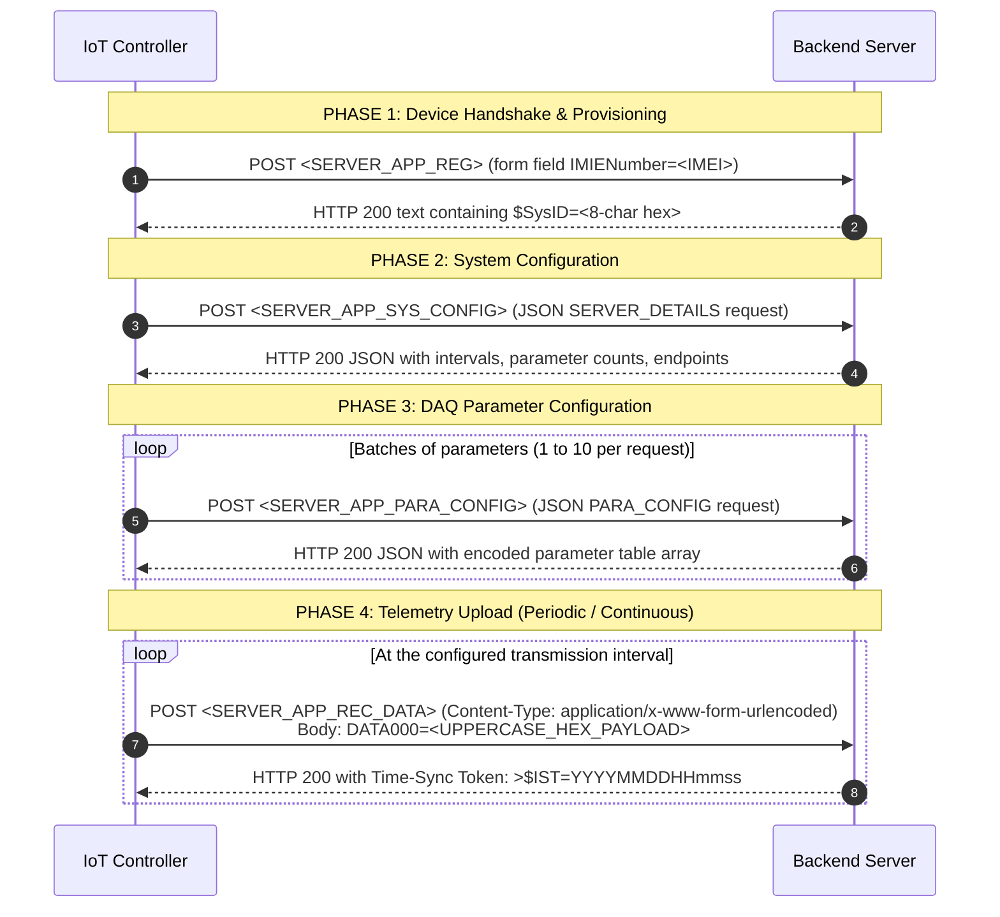

# IoT Controller — Backend Server Implementation Guide

This guide describes the backend requests and responses implemented by this firmware. The device uses its cellular modem for server communication; it has no active Wi-Fi or Ethernet transport in this codebase.

---

## 1. System Architecture & Communication Flow

The device communicates with backend endpoints over HTTPS through its cellular modem (2G or 4G mode). The modem uses TLS 1.2 with SNI and validates the server certificate using a CA certificate provisioned in modem UFS as `ca.pem`. The firmware connects to the public Cloudflare Tunnel endpoint at `https://iot.mavinsandeep.co.in` on port `443`. Cloudflare Tunnel forwards requests over HTTP to the backend on port `8085`.



---

## 2. API Endpoints Specification

All routes must be served on the configured host and public HTTPS port (default `443`). Cloudflare Tunnel forwards them to the backend's HTTP listener on port `8085`. The CA certificate chain required to validate the public server certificate must be installed in the modem file system as `UFS:ca.pem` before these exchanges can succeed.

---

### Endpoint 1: Device Registration

On first registration, the firmware posts the form field `IMIENumber=<IMEI>` to `POST /api/register` (stored internally as `api/register`).

The response must contain the legacy token `$SysID=<8 hex characters>#`. The firmware extracts this token, stores the system ID, marks the device registered, and processes any additional legacy command fields in the response. Registration does **not** use the JSON configuration response parser.

Example response body:

```text
$SysID=5E0D0000#
```

---

### Endpoint 2: System Configuration (JSON POST)

Called by the device after registration to obtain operational intervals and endpoint routes.

* **Method:** `POST`
* **Path:** `POST /api/system-config` (stored internally as `api/system-config`)
* **JSON Body:**
  ```json
  {
    "TYPE": "SERVER_DETAILS",
    "SYSTEM_ID": "00000D5E"
  }
  ```

#### Expected Server Response (HTTP 200 JSON):
```json
{
  "SYSTEM_ID": "00000D5E",
  "SERVER_ADD": "iot.mavinsandeep.co.in",
  "SERVER_PORT": "443",
  "SERVER_PATH": "/",
  "SER_APP_DATA": "api/data",
  "NO_OF_PARAMETERS": "02",
  "DATA_ACQ_MINUTES": "00000001",
  "DATA_TRANS_MINUTES": "00000001"
}
```

#### Field Details:
| Field | Type | Description |
|---|---|---|
| `SYSTEM_ID` | String (8 hex) | Device System Identifier |
| `SERVER_ADD` | String (max 49) | Server address |
| `SERVER_PORT` | String (max 6) | Public HTTPS port (default `"443"`) |
| `SERVER_PATH` | String (max 49) | Base URI path prefix (default `"/"`) |
| `SER_APP_DATA` | String | Telemetry endpoint path (default `api/data`) |
| `NO_OF_PARAMETERS` | Hex string | At least two uppercase hex digits; firmware reads the first two (e.g. `02` = 2); max 200 entries |
| `DATA_ACQ_MINUTES` | Hex string | Eight-digit uppercase hex interval (e.g. `00000001` = 1) |
| `DATA_TRANS_MINUTES` | Hex string | Eight-digit uppercase hex interval (e.g. `00000001` = 1) |

The firmware requires the `SYSTEM_ID` string to match the registered ID and accepts `SERVER_ADD`, `SERVER_PORT`, `SERVER_PATH`, `SER_APP_DATA` (or the alias `SERVER_APP_DATA`), `NO_OF_PARAMETERS`, `DATA_ACQ_MINUTES`, and `DATA_TRANS_MINUTES`. Other response properties are ignored. The parameter count is read from its first two hex digits. Interval strings are converted to legacy tokens and the parser reads their final two hex digits. The parameter count is capped at 200 during initialization.

---

### Endpoint 3: DAQ Parameter Configuration (JSON POST)

Downloads the sensor / Modbus registers table into the device's EEPROM.

* **Method:** `POST`
* **Path:** `POST /api/param-config` (stored internally as `api/param-config`)
* **JSON Body:**
  ```json
  {
    "TYPE": "PARA_CONFIG",
    "SYS_ID": "00000D5E",
    "FROM": "000",
    "TO": "009"
  }
  ```

The firmware requests up to 10 entries per batch. `FROM` and `TO` are three-digit decimal indices. The firmware sends `SYS_ID` as an eight-character uppercase hexadecimal number, such as `00000D5E` for ID `0x00000D5E`.

Each entry in `PARA` is a one-element array holding the compact parameter string. The fixed header is 30 characters: source (2 decimal digits), type (2 decimal digits), RS485 settings (6 digits), timeout (4 decimal digits), multiplier (8 hex characters), and addition factor (8 hex characters). At offset 30 the optional RS485 request hex begins; `#` separates it from the parameter name. Built-in source values are `00`–`11`, and `12` selects RS485. The firmware stores at most 29 request characters and 9 name characters. There are no parameter-level IP-address or TCP-port fields in this format.

#### Expected Server Response (HTTP 200 JSON):
```json
{
  "TYPE": "PARA_CONFIG",
  "FROM": "000",
  "TO": "001",
  "PARA": [
    ["120001300030003F80000000000000010300000002C40B#Active Power"],
    ["120001300030003F8000000000000001030002000265CB#Reactive Power"]
  ]
}
```

#### Compact Parameter String Specification:
The firmware parses a **30-character fixed header**, followed by a hexadecimal RS485 request packet and parameter name delimited by `#`.

$$\underbrace{\text{SS}}_{0-1}\underbrace{\text{TT}}_{2-3}\underbrace{\text{F}}_{4}\underbrace{\text{D}}_{5}\underbrace{\text{B}}_{6}\underbrace{\text{b}}_{7}\underbrace{\text{P}}_{8}\underbrace{\text{S}}_{9}\underbrace{\text{TOUT}}_{10-13}\underbrace{\text{MUL\_HEX}}_{14-21}\underbrace{\text{ADD\_HEX}}_{22-29}\underbrace{\text{MODBUS\_REQ}}_{30\dots\#}\text{\#}\underbrace{\text{NAME}}_{\dots\text{end}}$$

| Offset | Length | Name | Encoding | Description |
|---|---|---|---|---|
| `[00..01]` | 2 | `ucParaSource` | 2 Decimal Digits | `00`: no source; `01`: supply; `02`: temperature; `03`–`06`: V1–V4; `07`–`08`: I1–I2; `09`: digital input; `10`: frequency; `11`: pulse count; `12`: RS485. |
| `[02..03]` | 2 | `ucParaType` | 2 Decimal Digits | Firmware processing code: `01` thermistor, `02` threshold, `04`–`23` stored-value slots, `25` special Modbus record. |
| `[04]` | 1 | `ucRS485Mode` | 1 Decimal Digit | RS485 mode passed to the Modbus handler |
| `[05]` | 1 | `ucRS485DataType` | 1 Decimal Digit | Data type passed to the Modbus handler |
| `[06]` | 1 | `ucBaudRate` | 1 Decimal Digit | `0`: 9600, `1`: 19200, `2`: 38400, `3`: 115200, `4`: 4800, `5`: 2400 |
| `[07]` | 1 | `ucDataBits` | 1 Decimal Digit | `0`: 8 bits, `1`: 7 bits |
| `[08]` | 1 | `ucParity` | 1 Decimal Digit | `0`: None, `1`: Odd, `2`: Even |
| `[09]` | 1 | `ucStopBits` | 1 Decimal Digit | `0`: 1 stop bit, `1`: 2 stop bits |
| `[10..13]` | 4 | `uiTimeout` | 4 Decimal Digits | Response timeout in ms (e.g. `3000` = 3000 ms) |
| `[14..21]` | 8 | `fMultiplyFactor` | 8 Hex Chars (Big-Endian) | IEEE-754 multiplier; firmware reverses byte order when loading it (`3F800000` = `1.0f`) |
| `[22..29]` | 8 | `fAdditionFactor` | 8 Hex Chars (Big-Endian) | IEEE-754 addition factor; firmware reverses byte order when loading it (`00000000` = `0.0f`) |
| `[30..#)` | Var | `ucRS485Packet` | Hex String | RS485 request packet. The firmware stores at most 29 characters (15 bytes) and reads source `12` through RS485. |
| `#` | 1 | Delimiter | Literal `#` | Separator |
| `(#..end]` | Var | `ucParaStr` | ASCII String | Display name; firmware stores at most 9 characters. Other parameter fields are zeroed when this compact record is loaded. |

The compact parser currently handles built-in source IDs `00`–`11` and RS485 source `12`; source IDs for a second RS485 port or Modbus TCP are not handled by `acquireData()` in this firmware.

---

### Endpoint 4: Telemetry / Sensor Data Ingestion (`POST`)

Uploaded periodically by the device.

* **Method:** `POST`
* **Path:** `POST /api/data` (stored internally as `api/data`)
* **Headers:** `Content-Type: application/x-www-form-urlencoded`
* **Body:**
  ```http
  DATA000=050000005E0D0000191126153000280100000100000002000000E17A48420000AC41
  ```

#### Wire Record Payload Structure:
The string following `DATA000=` is pure uppercase hexadecimal encoding.

$$\text{DATA000}=\underbrace{\text{HDR}_{52\text{ hex chars}}}_{\text{26-byte Wire Header}}\quad+\quad\underbrace{\text{VAL}_{1}}_{8\text{ hex chars}}\quad+\quad\underbrace{\text{VAL}_{2}}_{8\text{ hex chars}}\quad+\dots+\quad\underbrace{\text{VAL}_{N}}_{8\text{ hex chars}}$$

#### A. 26-Byte Wire Header (First 52 Hex Characters):
| Hex Index | Length | Name | Type | Description |
|---|---|---|---|---|
| `00..07` | 8 chars (4 B) | `WriteCounter` | UINT32 (LE) | Flash write index; incremented after each record |
| `08..15` | 8 chars (4 B) | `SystemID` | UINT32 (LE) | 32-bit hardware device System ID |
| `16..27` | 12 chars | `Timestamp` | Decimal digit pairs | Date & Time: `DDMMYYHHMMSS` |
| `28..29` | 2 decimal characters | `SignalStrength` | Decimal text | `AT+CSQ` signal-quality index, clamped to `02` above 40; not dBm |
| `30..31` | 2 ASCII digits | `Relay1` | ASCII | Digital input `P10.2` (`'0'` or `'1'`) |
| `32..33` | 2 ASCII digits | `Relay2` | ASCII | Digital input `P0.4` (`'0'` or `'1'`) |
| `34..35` | 2 ASCII digits | `Relay3` | ASCII | Digital input `P13.0` (`'0'` or `'1'`) |
| `36..43` | 8 chars (4 B) | `AcquisitionCounter` | UINT32 (LE) | `ulDataAcqCntr` acquisition counter |
| `44..51` | 8 chars (4 B) | `ParamCount` | UINT32 (LE) | Count ($N$) of sensor parameters following in body |

#### B. Telemetry Values ($N \times 8$ Hex Characters):
Following the 52 header characters, each parameter value occupies **8 hex characters** representing a **32-bit IEEE-754 Little-Endian float**:

* **Normal Float:** `E17A4842` represents `50.12f` as four little-endian bytes.
* **Offline / Timeout Sentinel:** `-2222.0f` is sent as `00E00AC5` (little-endian float bytes).
* **Communication Error / Bad CRC Sentinel:** `-3333.0f` is sent as `005050C5` (little-endian float bytes).

#### Server Response Requirement:
The device requires a specific acknowledgment string containing the Indian Standard Time (IST) to synchronize its on-board MCP7940 RTC:

* **HTTP Status:** `200 OK`
* **Response Body (Text):**
  ```text
  Packet Inserted >$IST=20261119153000#
  ```
  *(Format: `>$IST=YYYYMMDDHHmmss#`)*

> [!WARNING]
> If the response body does not contain `>$IST=...#` or returns a 4xx/5xx code, the device will mark transmission as failed, retain the record in SPI flash, and retry uploading.

---

## 3. Database Schema Recommendations

### PostgreSQL Schema DDL:

```sql
-- 1. Devices Table
CREATE TABLE devices (
    system_id VARCHAR(8) PRIMARY KEY,      -- Wire-order hex string e.g. '5E0D0000'
    imei VARCHAR(15) UNIQUE NOT NULL,       -- Device hardware IMEI
    name VARCHAR(100),
    server_add VARCHAR(50) DEFAULT 'iot.mavinsandeep.co.in',
    server_port VARCHAR(6) DEFAULT '443',
    server_path VARCHAR(50) DEFAULT '/',
    registration_app VARCHAR(38) DEFAULT 'api/register',
    system_config_app VARCHAR(38) DEFAULT 'api/system-config',
    parameter_config_app VARCHAR(38) DEFAULT 'api/param-config',
    data_app VARCHAR(38) DEFAULT 'api/data',
    acq_interval_min INT DEFAULT 1,
    trans_interval_min INT DEFAULT 5,
    last_seen_at TIMESTAMP WITH TIME ZONE,
    created_at TIMESTAMP WITH TIME ZONE DEFAULT NOW()
);

-- 2. DAQ Parameters Definition Table
CREATE TABLE device_parameters (
    id SERIAL PRIMARY KEY,
    system_id VARCHAR(8) REFERENCES devices(system_id) ON DELETE CASCADE,
    param_index INT NOT NULL,              -- 0 to 199
    param_name VARCHAR(9) NOT NULL,         -- firmware stores at most 9 characters
    source_type INT NOT NULL,              -- built-in source 0-11 or RS485 source 12
    para_type INT DEFAULT 0,
    rs485_mode INT DEFAULT 0,
    rs485_data_type INT DEFAULT 0,
    baud_rate INT DEFAULT 3,
    data_bits INT DEFAULT 0,
    parity INT DEFAULT 0,
    stop_bits INT DEFAULT 0,
    timeout_ms INT DEFAULT 3000,
    mul_factor REAL DEFAULT 1.0,
    add_factor REAL DEFAULT 0.0,
    modbus_req_hex VARCHAR(29),             -- firmware stores at most 29 hex characters
    UNIQUE(system_id, param_index)
);

-- 3. RTU Relay Modules with independent per-channel coil registers
CREATE TABLE relay_modules (
    id BIGSERIAL PRIMARY KEY,
    system_id VARCHAR(8) REFERENCES devices(system_id) ON DELETE CASCADE,
    slave_id SMALLINT NOT NULL CHECK (slave_id BETWEEN 1 AND 247),
    write_function SMALLINT NOT NULL DEFAULT 5 CHECK (write_function = 5),
    on_value INT NOT NULL DEFAULT 65280 CHECK (on_value = 65280),
    off_value INT NOT NULL DEFAULT 0 CHECK (off_value = 0),
    UNIQUE(system_id, slave_id)
);

CREATE TABLE relay_module_channels (
    module_id BIGINT REFERENCES relay_modules(id) ON DELETE CASCADE,
    channel SMALLINT NOT NULL CHECK (channel BETWEEN 1 AND 8),
    coil_register INT NOT NULL CHECK (coil_register BETWEEN 0 AND 65535),
    PRIMARY KEY(module_id, channel),
    UNIQUE(module_id, coil_register)
);

-- 4. Raw Telemetry Records (Time-Series Table)
CREATE TABLE telemetry_records (
    id BIGSERIAL PRIMARY KEY,
    system_id VARCHAR(8) REFERENCES devices(system_id),
    device_timestamp TIMESTAMP WITHOUT TIME ZONE NOT NULL,
    write_counter BIGINT NOT NULL,
    acquisition_counter BIGINT NOT NULL,
    signal_strength INT,
    relay1_status BOOLEAN,
    relay2_status BOOLEAN,
    relay3_status BOOLEAN,
    received_at TIMESTAMP WITH TIME ZONE DEFAULT NOW()
);

-- 5. Parameter Values
CREATE TABLE telemetry_values (
    telemetry_id BIGINT REFERENCES telemetry_records(id) ON DELETE CASCADE,
    param_index INT NOT NULL,
    value DOUBLE PRECISION,
    is_timeout BOOLEAN DEFAULT FALSE,
    is_error BOOLEAN DEFAULT FALSE,
    PRIMARY KEY(telemetry_id, param_index)
);

CREATE INDEX idx_telemetry_sys_time ON telemetry_records (system_id, device_timestamp DESC);
```

---

## 4. Complete Reference Implementation: Python (FastAPI)

Below is a complete, working backend server in Python utilizing **FastAPI**:

```python
"""
IoT Controller Backend Server Implementation
Requirements:
    pip install fastapi uvicorn
Run:
    python server.py
"""

from fastapi import FastAPI, Request
from fastapi.responses import PlainTextResponse, JSONResponse
from datetime import datetime
import struct

app = FastAPI(title="IoT Controller Backend Server")

def parse_bcd(byte_val: int) -> int:
    return ((byte_val >> 4) * 10) + (byte_val & 0x0F)

def decode_data000_payload(hex_str: str):
    """
    Decodes the 26-byte wire header and float array from DATA000 hex payload.
    """
    raw = bytes.fromhex(hex_str)
    if len(raw) < 26:
        raise ValueError("Payload too short for 26-byte header")

    # Header parsing
    write_cnt = struct.unpack("<I", raw[0:4])[0]
    sys_id_hex = raw[4:8].hex().upper()  # 4 bytes little-endian
    
    # 6 BCD bytes: DD MM YY HH MM SS
    day = parse_bcd(raw[8])
    month = parse_bcd(raw[9])
    year = 2000 + parse_bcd(raw[10])
    hour = parse_bcd(raw[11])
    minute = parse_bcd(raw[12])
    second = parse_bcd(raw[13])
    timestamp = datetime(year, month, day, hour, minute, second)

    # Firmware formats signal strength as two decimal characters in the hex text.
    signal_strength = int(hex_str[28:30], 10)
    relay1 = raw[15] in (1, ord('1'))
    relay2 = raw[16] in (1, ord('1'))
    relay3 = raw[17] in (1, ord('1'))
    acquisition_cnt = struct.unpack("<I", raw[18:22])[0]
    param_count = struct.unpack("<I", raw[22:26])[0]

    # Sensor values parsing (param_count * 4 bytes float LE)
    values = []
    offset = 26
    for i in range(param_count):
        if offset + 4 > len(raw):
            break
        val_bytes = raw[offset:offset+4]
        float_val = struct.unpack("<f", val_bytes)[0]
        
        status = "OK"
        if round(float_val, 1) == -2222.0:
            status = "TIMEOUT"
        elif round(float_val, 1) == -3333.0:
            status = "COMM_ERROR"

        values.append({
            "index": i,
            "value": float_val if status == "OK" else None,
            "status": status
        })
        offset += 4

    return {
        "write_cnt": write_cnt,
        "sys_id": sys_id_hex,
        "timestamp": timestamp.isoformat(),
        "signal_strength": signal_strength,
        "relays": [relay1, relay2, relay3],
        "acquisition_cnt": acquisition_cnt,
        "param_count": param_count,
        "values": values
    }


# =====================================================================
# 1. Config & Provisioning Handlers
# =====================================================================
@app.post("/api/register")
async def register_device(request: Request):
    form_data = await request.form()
    imei = form_data.get("IMIENumber")
    if not imei:
        return PlainTextResponse("Bad Request: missing IMIENumber", status_code=400)
    # Look up or create the device using the IMEI, then return its assigned ID.
    return PlainTextResponse("$SysID=5E0D0000#", status_code=200)


@app.post("/api/system-config")
@app.post("/api/param-config")
async def handle_hw_request(request: Request):
    params = await request.json()

    req_type = params.get("type") or params.get("TYPE")
    key = params.get("SYSTEM_ID") or params.get("SYS_ID")

    # 1. SYSTEM / SERVER CONFIGURATION
    if req_type == "SERVER_DETAILS":
        return JSONResponse({
            "SYSTEM_ID": "00000D5E",
            "SERVER_ADD": "iot.mavinsandeep.co.in",
            "SERVER_PORT": "443",
            "SERVER_PATH": "/",
            "SER_APP_DATA": "api/data",
            "NO_OF_PARAMETERS": "02",
            "DATA_ACQ_MINUTES": "00000001",
            "DATA_TRANS_MINUTES": "00000001"
        })

    # 2. PARAMETERS CONFIGURATION
    if req_type == "PARA_CONFIG":
        from_idx = int(params.get("FROM", 0))
        to_idx = int(params.get("TO", 1))
        
        # Sample parameters
        sample_params = [
            "120001300030003F80000000000000010300000002C40B#Active P",
            "120001300030003F8000000000000001030002000265CB#Reactive"
        ]
        
        selected = [[p] for p in sample_params[from_idx:to_idx+1]]
        returned_to = from_idx + len(selected) - 1
        return JSONResponse({
            "TYPE": "PARA_CONFIG",
            "FROM": f"{from_idx:03d}",
            "TO": f"{returned_to:03d}",
            "PARA": selected
        })

    return JSONResponse({"status": "error", "msg": "unknown request"}, status_code=400)


@app.post("/api/relay-config")
async def handle_relay_modules_config(request: Request):
    params = await request.json()
    system_id = params.get("SYSTEM_ID")
    if system_id != "00000D5E":
        return JSONResponse({"status": "error", "msg": "unknown device"}, status_code=404)
    # Load per-device module mappings and MQTT credentials from the backend database.
    return JSONResponse({
        "TYPE": "RELAY_MODULE_CONFIG",
        "SYSTEM_ID": system_id,
        "MQTT_BROKER": "broker.example.net",
        "MQTT_PORT": 1883,
        "MQTT_CLIENT_ID": "device-00000D5E",
        "MQTT_USERNAME": "device-user",
        "MQTT_PASSWORD": "device-secret",
        "MQTT_COMMAND_TOPIC": "devices/00000D5E/relay/set",
        "MQTT_STATUS_TOPIC": "devices/00000D5E/relay/status",
        "MODULES": [
            {"slaveId": 1, "channels": 8, "writeFunction": 5,
             "onValue": 65280, "offValue": 0,
             "relays": [
                 {"channel": 1, "register": 0}, {"channel": 2, "register": 1},
                 {"channel": 3, "register": 2}, {"channel": 4, "register": 3},
                 {"channel": 5, "register": 4}, {"channel": 6, "register": 5},
                 {"channel": 7, "register": 6}, {"channel": 8, "register": 7}
             ]}
        ]
    })


# =====================================================================
# 2. Telemetry Ingestion Handler
# =====================================================================
@app.post("/api/data")
async def handle_telemetry(request: Request):
    form_data = await request.form()
    data_payload = form_data.get("DATA000")

    if not data_payload:
        return PlainTextResponse("Bad Request: missing DATA000", status_code=400)

    try:
        decoded = decode_data000_payload(data_payload)
        print(f"[TELEMETRY RECEIVED] Device: {decoded['sys_id']} @ {decoded['timestamp']}")
        print(f"  Counters: Write={decoded['write_cnt']}, Acquisition={decoded['acquisition_cnt']}")
        print(f"  Values ({len(decoded['values'])}): {decoded['values']}")

        # Build IST Clock-Sync ACK token required by firmware
        now_ist = datetime.now().strftime("%Y%m%d%H%M%S")
        response_text = f"Packet Inserted >$IST={now_ist}#"
        return PlainTextResponse(response_text, status_code=200)

    except Exception as e:
        print(f"Error decoding payload: {e}")
        return PlainTextResponse(f"Bad Request: {e}", status_code=400)


if __name__ == "__main__":
    import uvicorn
    # Keep the app on an internal port and terminate TLS at the public reverse proxy.
    uvicorn.run(app, host="127.0.0.1", port=8085)
```

The firmware connects to `https://iot.mavinsandeep.co.in` on port `443`. Cloudflare Tunnel terminates TLS and forwards requests over HTTP to the backend process on port `8085` (the Uvicorn snippet is a local HTTP development server). Install the public tunnel endpoint's trusted CA chain on the modem as `UFS:ca.pem`. The certificate must be valid for the configured DNS name because the firmware enables SNI and server certificate verification.

---

## Relay module configuration and MQTT control

External relay modules are configured independently from the controller’s sensor parameters. The firmware downloads this endpoint after the parameter configuration succeeds:

```http
POST /api/relay-config
Content-Type: application/json
```

Request:

```json
{
  "TYPE": "RELAY_MODULE_CONFIG",
  "SYSTEM_ID": "00000D5E"
}
```

Return a JSON object using this schema. `MODULES` may contain zero through 16 modules; each configured module uses eight channels. One `slaveId` is the RTU address shared by all eight channels on that module. Each `relays` item maps a logical channel to its own Modbus coil register. The RTU line is fixed to 9600 baud, 8 data bits, no parity, one stop bit.

```json
{
  "TYPE": "RELAY_MODULE_CONFIG",
  "SYSTEM_ID": "00000D5E",
  "MQTT_BROKER": "broker.example.net",
  "MQTT_PORT": 1883,
  "MQTT_CLIENT_ID": "device-00000D5E",
  "MQTT_USERNAME": "device-user",
  "MQTT_PASSWORD": "device-secret",
  "MQTT_COMMAND_TOPIC": "devices/00000D5E/relay/set",
  "MQTT_STATUS_TOPIC": "devices/00000D5E/relay/status",
  "MODULES": [
    {
      "slaveId": 1, "channels": 8, "writeFunction": 5,
      "onValue": 65280, "offValue": 0,
      "relays": [
        { "channel": 1, "register": 0 }, { "channel": 2, "register": 1 },
        { "channel": 3, "register": 2 }, { "channel": 4, "register": 3 },
        { "channel": 5, "register": 4 }, { "channel": 6, "register": 5 },
        { "channel": 7, "register": 6 }, { "channel": 8, "register": 7 }
      ]
    },
    {
      "slaveId": 2, "channels": 8, "writeFunction": 5,
      "onValue": 65280, "offValue": 0,
      "relays": [
        { "channel": 1, "register": 0 }, { "channel": 2, "register": 1 },
        { "channel": 3, "register": 2 }, { "channel": 4, "register": 3 },
        { "channel": 5, "register": 4 }, { "channel": 6, "register": 5 },
        { "channel": 7, "register": 6 }, { "channel": 8, "register": 7 }
      ]
    }
  ]
}
```

`SYSTEM_ID` must match the requesting device. Each `slaveId` must be unique among configured modules, in the Modbus RTU range 1–247, and distinct from every other slave on the shared RS485 bus. Set the physical module's RTU address to this same `slaveId`; the firmware uses the configured address and does not reprogram it. `channels` is required to be 8. The `relays` array must contain one unique mapping for each channel 1–8; `register` is that channel's zero-based coil register and may be configured independently per channel. `writeFunction` must be `5` (Modbus Write Single Coil), `onValue` must be `65280` (`FF00`), and `offValue` must be `0` (`0000`). Values are decimal JSON integers, transmitted high byte first. The supplied datasheet's default map is channel 1→register 0 through channel 8→register 7. The firmware persists this relay configuration separately from sensor acquisition parameters in external EEPROM. An invalid response leaves the separate download flag set so the device retries the endpoint.

Publish relay commands to `MQTT_COMMAND_TOPIC` as JSON. `module` identifies the configured module by its one-byte Modbus slave ID written as two hexadecimal characters; `channel` is decimal 1–8 and selects that channel's mapped register.

```json
{
  "commandId": "cmd-1042",
  "module": "01",
  "channel": "03",
  "state": "ON"
}
```

At startup, the firmware configures the modem’s MQTT receive mode and MQTT 3.1.1, opens the configured broker, authenticates with the supplied client credentials, and subscribes to the command topic at QoS 1. It handles modem receive and disconnect URCs and runs a disconnect/close/reconnect sequence after failures. Use `state` values `ON` and `OFF`. The device maps the request to the module’s configured coil address and writes it using Modbus RTU function 05 (`FF00` for ON, `0000` for OFF). It checks the Modbus response echo before reporting success. The device handles one channel command at a time and waits for its active sensor bus transaction to finish before issuing a write. Invalid modules, channels, topics, or states are ignored.

For a command with an optional `commandId`, the device publishes the result to `MQTT_STATUS_TOPIC` using the modem’s fixed-length `QMTPUBEX` command at QoS 1:

```json
{
  "commandId": "cmd-1042",
  "module": "01",
  "channel": "3",
  "state": "ON",
  "result": "OK"
}
```

`result` is `ERROR` when the Modbus response fails or does not echo the requested FC05 frame. Each RTU request is `[slaveId, 05, registerHi, registerLo, valueHi, valueLo, crcLo, crcHi]`. For example, module address `01`, channel 3 mapped to register `2`, ON produces `01 05 00 02 FF 00 2D FA`, matching the datasheet. The firmware computes the CRC from the configured address, register, and state. Keep command and status topic ACLs restricted to this device. The firmware currently uses a non-TLS MQTT connection; configure a broker endpoint reachable over the cellular data connection.

The HTTPS exchange transports the downloaded broker credentials. Install the server's trusted CA chain on the modem as `UFS:ca.pem`; the firmware configures TLS 1.2 and validates the server certificate. MQTT is a separate connection and currently uses the broker credentials without a TLS AT-command setup.

## 5. Testing & Verification Guide

For local backend development, these requests target Uvicorn directly over HTTP on port `8085`. Devices connect over HTTPS to `iot.mavinsandeep.co.in` on port `443`; Cloudflare Tunnel forwards the traffic to the HTTP backend.

### Test 1: Fetch System Configuration
```bash
curl -X POST "http://localhost:8085/api/system-config" \
     -H "Content-Type: application/json" \
     -d '{"TYPE":"SERVER_DETAILS","SYSTEM_ID":"00000D5E"}'
```
**Expected Response:** JSON with `SYSTEM_ID`, `SERVER_ADD`, `NO_OF_PARAMETERS`, etc.

---

### Test 2: Fetch Parameter Configuration
```bash
curl -X POST "http://localhost:8085/api/param-config" \
     -H "Content-Type: application/json" \
     -d '{"TYPE":"PARA_CONFIG","SYS_ID":"00000D5E","FROM":"000","TO":"001"}'
```
**Expected Response:** JSON containing the `"PARA"` array with compact strings.

---

### Test 3: Upload Sample Telemetry Record
The following sample payload contains:
* Header: Write Cnt = 1, SysID = `5E0D0000`, Timestamp = `19/11/26 15:30:00`, acquisition counter = 1, Params = 2
* Body: Param 0 = `50.12f` (`E17A4842`), Param 1 = `100.0f` (`0000C842`)

```bash
curl -X POST "http://localhost:8085/api/data" \
     -H "Content-Type: application/x-www-form-urlencoded" \
     -d "DATA000=010000005E0D0000191126153000280100000100000002000000E17A48420000C842"
```

**Expected Response (HTTP 200):**
```text
Packet Inserted >$IST=20261119153000#
```
