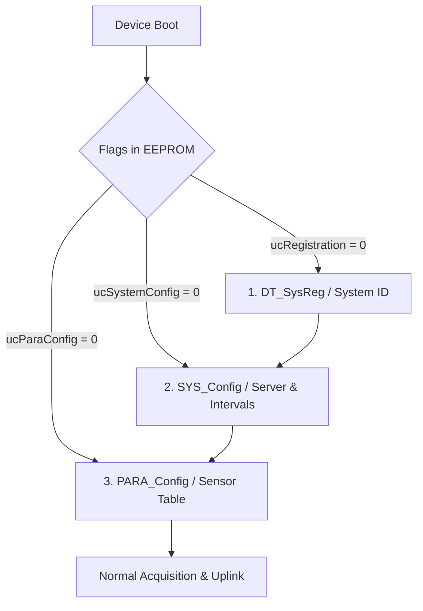
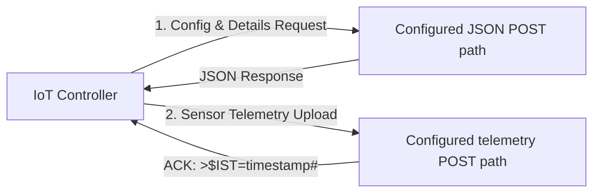

# IoT Control — JSON Specification & Command Reference

**Firmware Target:** Renesas RL78/G13 (`R5F100PL`)  
**Architecture:** Bare-metal, interrupt-driven, cellular-modem HTTPS transport (EC200U)
**Document Scope:** JSON schemas and command details documented here must be interpreted against the firmware implementation. Backend configuration and telemetry exchanges use the cellular HTTPS client; MQTT relay control uses its separate broker connection.

---

## 1. Transport & Framing Specification

* **Port:** UART2 (Debug Console) / cellular modem HTTPS.
* **UART Configuration:** Default `115200 bps`, `8` data bits, `No` parity, `1` stop bit (`8N1`).
* **Debug input:** The firmware recognizes JSON `REQ` objects and legacy `$COMMAND#` tokens. The JSON debug interface handles `GET_SYS_INFO` and `PARA_VALUE`.

---

## 2. Configuration Download Schemas (Server $\to$ Device)

The device dynamically downloads and persists three distinct configuration models into non-volatile EEPROM (Microchip 24LC256).



---

### A. System Configuration (`SERVER_DETAILS` / `SYS_Config`)

Downloaded by HTTPS POST to the system-configuration application path. The device sends `{"TYPE":"SERVER_DETAILS","SYSTEM_ID":"<8-char hex>"}` and applies a JSON response only when `SYSTEM_ID` matches the registered device. The active firmware maps supported response fields to legacy command tokens internally. The server CA chain must be provisioned on the modem as `UFS:ca.pem`.

#### JSON Schema
```json
{
  "$schema": "https://json-schema.org/draft/2020-12/schema",
  "title": "SystemConfigurationDownload",
  "type": "object",
  "properties": {
    "SYSTEM_ID": {
      "type": "string",
      "description": "8-character hexadecimal 32-bit system ID, emitted in most-significant-digit-first order (e.g., '00000D5E' for numeric ID 3422)",
      "maxLength": 8
    },
    "SERVER_ADD": {
      "type": "string",
      "description": "Server IP address or hostname for data and configuration",
      "maxLength": 49
    },
    "SERVER_PORT": {
      "type": "string",
      "description": "Public HTTPS server port (default 443)",
      "maxLength": 6
    },
    "SERVER_PATH": {
      "type": "string",
      "description": "Base server path prefix",
      "maxLength": 49
    },
    "SER_APP_DATA": {
      "type": "string",
      "description": "Endpoint application name for data upload (also accepts 'SERVER_APP_DATA')",
      "maxLength": 49
    },
    "NO_OF_PARAMETERS": {
      "type": "string",
      "description": "Hexadecimal count token; firmware reads the first two digits (e.g. '0A' = 10)",
      "minLength": 2,
      "maxLength": 8
    },
    "DATA_ACQ_MINUTES": {
      "type": "string",
      "description": "Eight-digit uppercase hexadecimal interval value (e.g. '00000001' = 1)",
      "minLength": 8,
      "maxLength": 8
    },
    "DATA_TRANS_MINUTES": {
      "type": "string",
      "description": "Eight-digit uppercase hexadecimal interval value (e.g. '00000005' = 5)",
      "minLength": 8,
      "maxLength": 8
    }
  }
}
```

#### Example Payload:
```json
{
  "SYSTEM_ID": "00000D5E",
  "SERVER_ADD": "iot.mavinsandeep.co.in",
  "SERVER_PORT": "443",
  "SERVER_PATH": "/",
  "SER_APP_DATA": "api/data",
  "NO_OF_PARAMETERS": "0A",
  "DATA_ACQ_MINUTES": "00000001",
  "DATA_TRANS_MINUTES": "00000005"
}
```

The system configuration request sends the numeric system ID as eight uppercase hex digits, such as `00000D5E`. The config response must return the same string for the device to accept it.

---

### B. DAQ Parameter Configuration (`PARA_CONFIG`)

Downloaded by HTTPS POST to the parameter-configuration application path in batches of up to 10 entries. The request contains `TYPE`, `SYS_ID`, `FROM`, and `TO`; the response contains a `PARA` array.

#### JSON Schema
```json
{
  "$schema": "https://json-schema.org/draft/2020-12/schema",
  "title": "DAQParameterConfigurationDownload",
  "type": "object",
  "required": ["TYPE", "FROM", "TO", "PARA"],
  "properties": {
    "TYPE": {
      "type": "string",
      "const": "PARA_CONFIG"
    },
    "FROM": {
      "type": "string",
      "description": "Start EEPROM index for this batch (3-digit decimal string, e.g. '000')"
    },
    "TO": {
      "type": "string",
      "description": "End EEPROM index for this batch inclusive (3-digit decimal string, e.g. '009')"
    },
    "PARA": {
      "type": "array",
      "description": "Array of 1-element arrays containing compact parameter definition strings",
      "items": {
        "type": "array",
        "items": { "type": "string" },
        "minItems": 1,
        "maxItems": 1
      }
    }
  }
}
```

#### Compact Parameter String Format
Each element in `"PARA"` contains the **30-character fixed header used by the firmware** followed by the RS485 request packet and display name separated by `#`:

$$\underbrace{\text{SS}}_{0-1}\underbrace{\text{TT}}_{2-3}\underbrace{\text{F}}_{4}\underbrace{\text{D}}_{5}\underbrace{\text{B}}_{6}\underbrace{\text{b}}_{7}\underbrace{\text{P}}_{8}\underbrace{\text{S}}_{9}\underbrace{\text{TOUT}}_{10-13}\underbrace{\text{MUL}}_{14-21}\underbrace{\text{ADD}}_{22-29}\underbrace{\text{REQ\_PACKET}}_{30\dots\#}\text{\#}\underbrace{\text{NAME}}_{\dots\text{end}}$$

| Character Offset | Field Name | Representation | Description |
|---|---|---|---|
| `[00..01]` | `ucSource` | 2 Decimal Digits | `00`: no source; `01`: supply; `02`: temperature; `03`–`06`: V1–V4; `07`–`08`: I1–I2; `09`: digital input; `10`: frequency; `11`: pulse count; `12`: RS485. |
| `[02..03]` | `ucType` | 2 Decimal Digits | Firmware processing code: `01` thermistor, `02` threshold, `04`–`23` stored-value slots, `25` special Modbus record. |
| `[04]` | `ucRS485Mode` | 1 Decimal Digit | RS485 mode passed to the Modbus handler |
| `[05]` | `ucRS485DataType` | 1 Decimal Digit | Data type passed to the Modbus handler |
| `[06]` | `ucBaudRate` | 1 Decimal Digit | `0`: 9600, `1`: 19200, `2`: 38400, `3`: 115200, `4`: 4800, `5`: 2400 |
| `[07]` | `ucDataBits` | 1 Decimal Digit | `0`: 8 bits, `1`: 7 bits |
| `[08]` | `ucParity` | 1 Decimal Digit | `0`: None, `1`: Odd, `2`: Even |
| `[09]` | `ucStopBits` | 1 Decimal Digit | `0`: 1 stop bit, `1`: 2 stop bits |
| `[10..13]` | `uiTimeout` | 4 Decimal Digits | Modbus response timeout in milliseconds (e.g. `3000` = 3000 ms) |
| `[14..21]` | `flMulFactor` | 8 Hex Characters | Big-endian IEEE-754 float multiplier (`3F800000` = 1.0f) |
| `[22..29]` | `flAddFactor` | 8 Hex Characters | Big-endian IEEE-754 float adder offset (`00000000` = 0.0f) |
| `[30..#)` | `ucRS485Packet` | Hex String | RS485 request packet; at most 29 characters (15 bytes) are stored |
| `#` | Delimiter | 1 Character | Separator between packet and name |
| `(#..end]` | `ucParaStr` | ASCII String | Display name; firmware stores at most 9 characters |

The firmware supports built-in source IDs `00`–`11` and RS485 source `12`. Fields not represented in this compact record are cleared when the parameter record is loaded.

#### Example Payload:
```json
{
  "TYPE": "PARA_CONFIG",
  "FROM": "000",
  "TO": "001",
  "PARA": [
    ["120001300030003F80000000000000010300000002C40B#Active Power"],
    ["120001300030003F8000000000000001030002000265CB#Reactive Power"]
  ]
}
```

---

---

## 3. Debug & Maintenance Command Reference (`CMD` & `REQ`)

---

### B. Query / Request Commands (`REQ`)

Queries use the `"REQ"` key and reply directly with data structures.

#### 1. System Status (`GET_SYS_INFO`)
```json
// Send:
{"REQ":"GET_SYS_INFO"}

// Response:
{
  "SYS_ID": "00000D5E",
  "NO_OF_PARA": "0002",
  "PENDING_FILES": "0003",
  "MODE": "0"
}
```
The fields are uppercase hexadecimal numbers. `MODE` comes from the stored internet-source byte; this firmware initializes that value to zero for modem operation.

#### 2. Live Parameter Values (`PARA_VALUE`)
Fetches acquired data from memory as 32-bit value hex strings. `START` and `SIZE` are two-digit hexadecimal parameter IDs; `SIZE` is the inclusive ending parameter ID, not a count. The returned values are emitted in most-significant-byte-first order by the debug formatter, unlike the little-endian byte order used in telemetry uploads.
```json
// Send (Hex indices):
{"REQ":"PARA_VALUE","START":"0","SIZE":"0A"}

// Response:
{
  "PARA_NO": "00",
  "SIZE": "0A",
  "VALUES": ["E17A4842", "00000000", "0000C842", "..."]
}
```

The device also supports the legacy `$DEBUG_SYSTEM#`, `$DEBUG_BOARD#`, `$DEBUG_PARA#`, `$ACQ_NOW#`, `$DEBUG_ALL#`, `$DEBUG_NW#`, `$DEBUG_RS485#`, `$DEBUG_NIL#`, and `$4G_CMD=<AT command>#` tokens. JSON `CMD` commands are not handled by the shown debug parser.

---

## 4. Outgoing Request Formats (Device $\to$ Server)

The firmware issues two types of requests to the backend server:



---

### A. Configuration & System Requests (Device $\to$ Server)

Configuration downloads use JSON POST requests to configured application paths in this firmware.

#### 1. Unit System Configuration Request (`SERVER_DETAILS`)
* **Transport:** HTTPS POST (TLS 1.2 with SNI; server certificate verified against `UFS:ca.pem`)
* **Target Path:** `https://<SERVER_ADD>:<SERVER_PORT>/<SERVER_PATH>/api/system-config` (default `https://iot.mavinsandeep.co.in/api/system-config`)
* **JSON Schema:**
```json
{
  "$schema": "https://json-schema.org/draft/2020-12/schema",
  "title": "UnitConfigRequest",
  "type": "object",
  "required": ["TYPE", "SYSTEM_ID"],
  "properties": {
    "TYPE": {
      "type": "string",
      "const": "SERVER_DETAILS"
    },
    "SYSTEM_ID": {
      "type": "string",
      "description": "8-digit hex string of the registered 32-bit System ID (e.g. '5E0D0000')",
      "maxLength": 8
    }
  }
}
```
* **Payload Example:**
```json
{
  "TYPE": "SERVER_DETAILS",
  "SYSTEM_ID": "00000D5E"
}
```

---

#### 2. DAQ Parameter Configuration Request (`PARA_CONFIG`)
* **Transport:** HTTPS POST
* **Target Path:** `https://<SERVER_ADD>:<SERVER_PORT>/<SERVER_PATH>/api/param-config`
* **JSON Schema:**
```json
{
  "$schema": "https://json-schema.org/draft/2020-12/schema",
  "title": "ParaConfigRequest",
  "type": "object",
  "required": ["TYPE", "SYS_ID", "FROM", "TO"],
  "properties": {
    "TYPE": {
      "type": "string",
      "const": "PARA_CONFIG"
    },
    "SYS_ID": {
      "type": "string",
      "description": "8-digit hex System ID",
      "maxLength": 8
    },
    "FROM": {
      "type": "string",
      "description": "3-digit decimal starting parameter index (e.g. '000')",
      "maxLength": 3
    },
    "TO": {
      "type": "string",
      "description": "3-digit decimal ending parameter index inclusive (e.g. '002')",
      "maxLength": 3
    }
  }
}
```
* **Payload Example:**
```json
{
  "TYPE": "PARA_CONFIG",
  "SYS_ID": "00000D5E",
  "FROM": "000",
  "TO": "002"
}
```

---

#### 3. IMEI Device Registration Request (`imieRegistration`)
* **Endpoint:** `POST /api/register`
* **Transport:** HTTPS POST (form-encoded)
* **Form POST:** `IMIENumber=865510081833552`

Registration is parsed as the legacy text response `$SysID=<8 hex characters>#`, not as JSON.

---

#### 4. External 8 Channel Relay Module Configuration

This is a separate configuration download after the system and parameter configuration stages. It configures multiple 12 V Modbus RTU 8 channel modules independently of sensor parameters and the controller’s local I/O.

* **Endpoint:** `POST /api/relay-config`
* **Method:** HTTPS POST with a JSON body
* **Request:**

```json
{
  "TYPE": "RELAY_MODULE_CONFIG",
  "SYSTEM_ID": "00000D5E"
}
```

* **Response:** `SYSTEM_ID`, MQTT broker address and port, client credentials, command and status topics, and a `MODULES` array. This endpoint is separate from parameter acquisition configuration: `PARA` describes sensor/register acquisition; `MODULES` describes relay RTU write frames. The firmware supports up to 16 modules, eight channels per module, and unique Modbus slave IDs from 1 through 247. One module `slaveId` is shared by its eight relays; its `relays` array maps every logical channel to its own coil register. Module slave IDs must also be unique on the shared RS485 bus. Modbus serial settings are fixed at 9600 8N1. Each module specifies `writeFunction: 5`, `onValue: 65280` (`FF00`), and `offValue: 0` (`0000`) as decimal JSON integers.

```json
{
  "TYPE": "RELAY_MODULE_CONFIG",
  "SYSTEM_ID": "00000D5E",
  "MQTT_BROKER": "broker.example.net",
  "MQTT_PORT": 1883,
  "MQTT_CLIENT_ID": "device-00000D5E",
  "MQTT_USERNAME": "device-user",
  "MQTT_PASSWORD": "device-secret",
  "MQTT_COMMAND_TOPIC": "devices/00000D5E/relay/set",
  "MQTT_STATUS_TOPIC": "devices/00000D5E/relay/status",
  "MODULES": [
    {
      "slaveId": 1, "channels": 8, "writeFunction": 5,
      "onValue": 65280, "offValue": 0,
      "relays": [
        { "channel": 1, "register": 0 }, { "channel": 2, "register": 1 },
        { "channel": 3, "register": 2 }, { "channel": 4, "register": 3 },
        { "channel": 5, "register": 4 }, { "channel": 6, "register": 5 },
        { "channel": 7, "register": 6 }, { "channel": 8, "register": 7 }
      ]
    }
  ]
}
```

One `slaveId` is the RTU address for the whole 8 channel module. Each `relays` item assigns a logical channel to its own zero-based coil register. The datasheet's default map is channel 1 → register 0 through channel 8 → register 7. The firmware requires exactly one unique register mapping for each channel 1–8.

The firmware configures MQTT 3.1.1 and direct message receive mode on the modem, then opens the broker, connects with the configured credentials, and subscribes to `MQTT_COMMAND_TOPIC` at QoS 1. It handles disconnect indications and retries the connection. Send commands in this form (`module` is the slave ID as two hex characters; `channel` is decimal 1–8):

```json
{
  "commandId": "cmd-1042",
  "module": "01",
  "channel": "03",
  "state": "ON"
}
```

`state` accepts `ON` or `OFF`. The firmware uses the selected module's `writeFunction` and that channel's mapped register, writing the configured `onValue` or `offValue` high byte first. The datasheet specifies function `5`, `onValue: 65280` (`FF00`), and `offValue: 0` (`0000`). It checks the response echo and publishes a QoS 1 result using `QMTPUBEX` to `MQTT_STATUS_TOPIC`:

For module address `01`, channel 3 mapped to register `2`, an ON command yields RTU bytes `01 05 00 02 FF 00 2D FA`. The firmware computes the CRC bytes for each command.

```json
{
  "commandId": "cmd-1042",
  "module": "01",
  "channel": "3",
  "state": "ON",
  "result": "OK"
}
```

The result is `ERROR` when the Modbus operation fails. Only one command is processed at a time, after any active sensor bus transaction. MQTT uses a non-TLS connection in this firmware.

### B. Telemetry & Sensor Data Upload (`DataTx` / `data.c`)

Telemetry records are uploaded periodically using an HTTPS POST to `https://<SERVER_ADD>:<SERVER_PORT>/<SERVER_PATH>/<SER_APP_DATA>` (default `https://iot.mavinsandeep.co.in/api/data`). Cloudflare Tunnel terminates public HTTPS and forwards requests to the HTTP backend on port `8085`. The tunnel certificate's CA chain must be provisioned in the modem as `UFS:ca.pem`.

* **Header:** `Content-Type: application/x-www-form-urlencoded`
* **Payload Structure:**
```
DATA000=<HEX_PAYLOAD>
```

#### Wire Record Hex Payload Breakdown:

$$\text{DATA000}=\underbrace{\text{HDR}_{52\text{ hex chars}}}_{\text{26-byte Wire Header}}\quad+\quad\underbrace{\text{VAL}_{1}}_{8\text{ hex chars}}\quad+\quad\underbrace{\text{VAL}_{2}}_{8\text{ hex chars}}\quad+\dots+\quad\underbrace{\text{VAL}_{N}}_{8\text{ hex chars}}$$

#### 1. 26-Byte Wire Header (52 hex chars)

| Bytes | Hex Chars | Field | Format | Example / Meaning |
|---|---|---|---|---|
| `0..3` | `0..7` | Write / Packet Counter | UINT32 Little-Endian | `05000000` $\to$ Record #5 |
| `4..7` | `8..15` | System ID | UINT32 Little-Endian | `5E0D0000` $\to$ System ID |
| `8..13` | `16..27` | Timestamp | 6 BCD Bytes | `19 11 26 15 30 00` $\to$ 2026-11-19 15:30:00 |
| `14` | `28..29` | Signal Strength (RSSI) | INT8 / 2 digits ASCII | RSSI in dBm |
| `15` | `30..31` | Relay 1 Status | ASCII Digit / Byte | `0` = Off, `1` = On |
| `16` | `32..33` | Relay 2 Status | ASCII Digit / Byte | `0` = Off, `1` = On |
| `17` | `34..35` | Relay 3 Status | ASCII Digit / Byte | `0` = Off, `1` = On |
| `18..21` | `36..43` | Acquisition Counter | UINT32 Little-Endian | Acquisition counter included in each record |
| `22..25` | `44..51` | Parameter Count ($N$) | UINT32 Little-Endian | `0A000000` $\to$ 10 parameters |

#### 2. Body ($N \times 4$ Bytes / $N \times 8$ Hex Chars)
Each acquired parameter value is appended as an **8-character IEEE-754 Little-Endian float hex string**:
* `E17A4842` $\to$ `50.12f` (little-endian float bytes)
* Timeout sentinel value: `-2222.0f` (`00E00AC5`, little-endian float bytes)
* Communication error / CRC error sentinel: `-3333.0f` (`005050C5`, little-endian float bytes)

#### Server Response & Time Sync
The server responds to each successful upload with an ACK that includes the current Indian Standard Time:
```
>$IST=YYYYMMDDHHmmss#
```
The firmware extracts this token using `RTC_updateFromIST()` and synchronizes the real-time clock.

