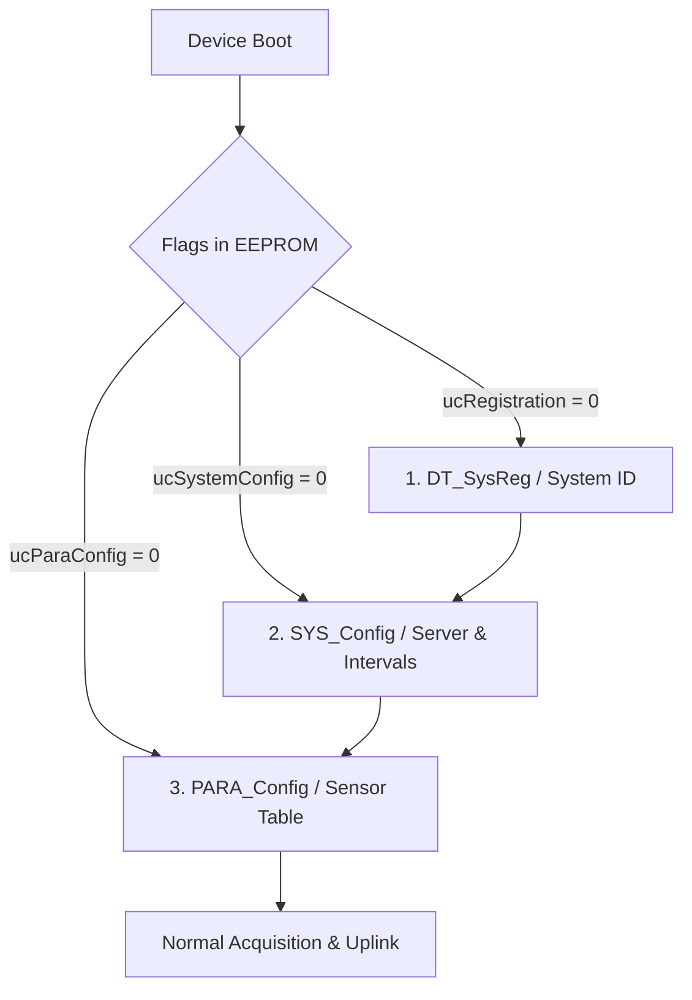
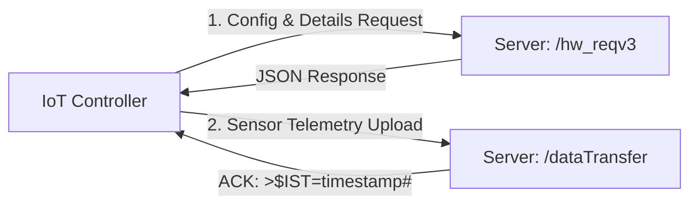

# IoT Control — JSON Specification & Command Reference

**Firmware Target:** Renesas RL78/G13 (`R5F100PL`)  
**Architecture:** Bare-metal, interrupt-driven, multi-transport (Ethernet W5500, Wi-Fi FCM360W, 4G EC200U)  
**Document Scope:** Full JSON Schemas and field definitions for **Config Download** (Server $\to$ Device) and **Debug / Maintenance Commands** (Console / UART / Network).

---

## 1. Transport & Framing Specification

* **Port:** UART2 (Debug Console) / Ethernet (Socket) / Wi-Fi / 4G Modem.
* **UART Configuration:** Default `115200 bps`, `8` data bits, `No` parity, `1` stop bit (`8N1`).
* **Framing:** Flat JSON object per transmission, strictly terminated with a newline (`\n` or `\r\n`).
* **Buffer Limit:** Maximum 512 bytes per command packet (`UART_DEBUG_REC_BUFFER_SIZE`).
* **Value Field Length:** Maximum 64 characters per extracted token (`JSON_VALUE_MAX_LEN`).
* **General Response Envelopes:**
  * **Success:** `{"status":"ok"}` or `{"status":"ok","msg":"<detail>"}`
  * **Error:** `{"status":"err","msg":"<reason>"}`
  * **Queries (`REQ`):** Dedicated payload object returned directly.

---

## 2. Configuration Download Schemas (Server $\to$ Device)

The device dynamically downloads and persists three distinct configuration models into non-volatile EEPROM (Microchip 24LC256).



---

### A. System Configuration (`SERVER_DETAILS` / `SYS_Config`)

Downloaded via HTTP GET `hw_reqv3?type=SERVER_DETAILS&KEY=<SYS_ID_HEX>` or injected over the serial terminal. Keys are decoded independently, allowing selective updates.

#### JSON Schema
```json
{
  "$schema": "https://json-schema.org/draft/2020-12/schema",
  "title": "SystemConfigurationDownload",
  "type": "object",
  "properties": {
    "SYSTEM_ID": {
      "type": "string",
      "description": "8-character little-endian hex string representing 32-bit system ID (e.g., '5E0D0000'). Setting this marks the device as registered.",
      "maxLength": 8
    },
    "SERVER_ADD": {
      "type": "string",
      "description": "Server IP address or hostname for data and configuration",
      "maxLength": 49
    },
    "SERVER_PORT": {
      "type": "string",
      "description": "Server port string (e.g., '80', '8080')",
      "maxLength": 6
    },
    "SERVER_PATH": {
      "type": "string",
      "description": "Base server path prefix",
      "maxLength": 49
    },
    "SER_APP_DATA": {
      "type": "string",
      "description": "Endpoint application name for data upload (also accepts 'SERVER_APP_DATA')",
      "maxLength": 49
    },
    "NO_OF_PARAMETERS": {
      "type": "string",
      "description": "Total active DAQ parameter count in hexadecimal (e.g. '00A' = 10, '064' = 100)"
    },
    "DATA_ACQ_MINUTES": {
      "type": "string",
      "description": "Sensor acquisition polling interval in hexadecimal seconds/minutes"
    },
    "DATA_TRANS_MINUTES": {
      "type": "string",
      "description": "Server data upload interval in hexadecimal seconds/minutes"
    },
    "MQTT_ADD": { "type": "string", "maxLength": 49, "description": "MQTT Broker hostname/IP" },
    "MQTT_PORT": { "type": "string", "maxLength": 6, "description": "MQTT Broker port (e.g. '1883')" },
    "MQTT_USN": { "type": "string", "maxLength": 24, "description": "MQTT Username" },
    "MQTT_PWD": { "type": "string", "maxLength": 24, "description": "MQTT Password" },
    "MQTT_TOPIC_PUB": { "type": "string", "maxLength": 49, "description": "Telemetry publish topic" },
    "MQTT_TOPIC_SUB": { "type": "string", "maxLength": 49, "description": "Command subscribe topic" },
    "FTP_ADD": { "type": "string", "maxLength": 49, "description": "FTP Server address" },
    "FTP_PORT": { "type": "string", "maxLength": 6, "description": "FTP Server port" },
    "FTP_USER": { "type": "string", "maxLength": 24, "description": "FTP Username" },
    "FTP_PWD": { "type": "string", "maxLength": 24, "description": "FTP Password" },
    "FTP_PATH": { "type": "string", "maxLength": 49, "description": "FTP Remote folder path" }
  }
}
```

#### Example Payload:
```json
{
  "SYSTEM_ID": "5E0D0000",
  "SERVER_ADD": "config.example.com",
  "SERVER_PORT": "80",
  "SERVER_PATH": "/",
  "SER_APP_DATA": "dataTransfer",
  "NO_OF_PARAMETERS": "00A",
  "DATA_ACQ_MINUTES": "01",
  "DATA_TRANS_MINUTES": "05"
}
```

---

### B. DAQ Parameter Configuration (`PARA_CONFIG`)

Downloaded via HTTP GET `hw_reqv3?type=PARA_CONFIG&KEY=<SYS_ID_HEX>` in batches (max 10 per batch) or sent via debug terminal.

#### JSON Schema
```json
{
  "$schema": "https://json-schema.org/draft/2020-12/schema",
  "title": "DAQParameterConfigurationDownload",
  "type": "object",
  "required": ["TYPE", "FROM", "TO", "PARA"],
  "properties": {
    "TYPE": {
      "type": "string",
      "const": "PARA_CONFIG"
    },
    "FROM": {
      "type": "string",
      "description": "Start EEPROM index for this batch (3-digit decimal string, e.g. '000')"
    },
    "TO": {
      "type": "string",
      "description": "End EEPROM index for this batch inclusive (3-digit decimal string, e.g. '009')"
    },
    "PARA": {
      "type": "array",
      "description": "Array of 1-element arrays containing compact parameter definition strings",
      "items": {
        "type": "array",
        "items": { "type": "string" },
        "minItems": 1,
        "maxItems": 1
      }
    }
  }
}
```

#### Compact Parameter String Format
Each element in `"PARA"` contains a **42-character fixed header** followed by the Modbus request packet and display name separated by `#`:

$$\underbrace{\text{SS}}_{0-1}\underbrace{\text{TT}}_{2-3}\underbrace{\text{F}}_{4}\underbrace{\text{D}}_{5}\underbrace{\text{B}}_{6}\underbrace{\text{b}}_{7}\underbrace{\text{P}}_{8}\underbrace{\text{S}}_{9}\underbrace{\text{TOUT}}_{10-13}\underbrace{\text{MUL}}_{14-21}\underbrace{\text{ADD}}_{22-29}\underbrace{\text{IP}}_{30-37}\underbrace{\text{PORT}}_{38-41}\underbrace{\text{REQ\_PACKET}}_{42\dots\#}\text{\#}\underbrace{\text{NAME}}_{\dots\text{end}}$$

| Character Offset | Field Name | Representation | Description |
|---|---|---|---|
| `[00..01]` | `ucSource` | 2 Decimal Digits | `01`: On-board ADC<br>`12`: RS485 Port 1 (RTU)<br>`13`: RS485 Port 2 (RTU)<br>`14`: Modbus-TCP (W5500) |
| `[02..03]` | `ucType` | 2 Decimal Digits | Channel subtype (`00`: Standard, `01`: Power meter, etc.) |
| `[04]` | `ucDataFormat` | 1 Decimal Digit | `0`: 32-bit Float, `1`: 16-bit Int, `2`: 32-bit Int, etc. |
| `[05]` | `ucDataType` | 1 Decimal Digit | Signed / Unsigned / Bitfield indicator |
| `[06]` | `ucBaudRate` | 1 Decimal Digit | `0`: 9600, `1`: 19200, `2`: 38400, `3`: 115200, `4`: 4800, `5`: 2400 |
| `[07]` | `ucDataBits` | 1 Decimal Digit | `0`: 8 bits, `1`: 7 bits |
| `[08]` | `ucParity` | 1 Decimal Digit | `0`: None, `1`: Odd, `2`: Even |
| `[09]` | `ucStopBits` | 1 Decimal Digit | `0`: 1 stop bit, `1`: 2 stop bits |
| `[10..13]` | `uiTimeout` | 4 Decimal Digits | Modbus response timeout in milliseconds (e.g. `3000` = 3000 ms) |
| `[14..21]` | `flMulFactor` | 8 Hex Characters | Big-endian IEEE-754 float multiplier (`3F800000` = 1.0f) |
| `[22..29]` | `flAddFactor` | 8 Hex Characters | Big-endian IEEE-754 float adder offset (`00000000` = 0.0f) |
| `[30..37]` | `ucIpAddr[4]` | 8 Hex Characters | 2 hex chars per octet (`C0A80072` = `192.168.0.114`) |
| `[38..41]` | `uiPort` | 4 Hex Characters | Big-endian 16-bit integer port (`01F6` = 502) |
| `[42..#)` | `ucReqPacket` | Hex String | Raw Modbus Request Frame (Slave ID + FC + Reg + Count + CRC) |
| `#` | Delimiter | 1 Character | Separator between packet and name |
| `(#..end]` | `ucParaName` | ASCII String | Human-readable parameter name (up to 31 characters) |

#### Example Payload:
```json
{
  "TYPE": "PARA_CONFIG",
  "FROM": "000",
  "TO": "001",
  "PARA": [
    ["140001300030003F80000000000000C0A8007201F6010300000002C40B#Active Power"],
    ["140001300030003F80000000000000C0A8007201F601030002000265CB#Reactive Power"]
  ]
}
```

---

---

## 3. Debug & Maintenance Command Reference (`CMD` & `REQ`)

---

### A. Diagnostic Level Configuration (`debugLevel`)

Sets individual subsystem verbosity flags in RAM (resets to defaults on reboot).

```json
{
  "CMD": "debugLevel",
  "acq": "0|1|2",
  "mbtcp": "0|1|2",
  "mb1": "0|1|2",
  "mb2": "0|1|2",
  "dtx": "0|1",
  "nw": "0|1",
  "all": "0|1"
}
```

* **`acq`**: Master acquisition group (sets `mbtcp`, `mb1`, `mb2` simultaneously).
* **`mbtcp`**: Modbus-TCP / Ethernet acquisition trace (`0`=off, `1`=concise `P[i] val`, `2`=full hex frames).
* **`mb1`**: RS485 Port 1 RTU trace (`0`=off, `1`=concise, `2`=full hex frames).
* **`mb2`**: RS485 Port 2 RTU trace (`0`=off, `1`=concise, `2`=full hex frames).
* **`dtx`**: Flash upload POST body display (`0`=off, `1`=show body text).
* **`nw`**: Uplink network event traces (W5500, EC200U 4G, FCM360W Wi-Fi).
* **`all`**: Master trace output toggle.

**Quick Switches:**
* `{"CMD":"DEBUG_ALL"}`: Turn on all subsystem logs.
* `{"CMD":"DEBUG_NIL"}`: Silence all debug channels immediately.
* `{"CMD":"DEBUG_NW"}`: Enable network interface uplink diagnostics.

---

### B. Network & Server Configuration

#### Set Endpoints (`setServer`)
Configures either the configuration download or the data upload server target.
```json
{"CMD":"setServer","ep":"config|data","addr":"config.example.com","port":"80","app":"dataTransfer"}
```

#### Set Authentication Credentials (`setAuth`)
Configures HTTP Basic Auth or MQTT credentials for an endpoint.
```json
{"CMD":"setAuth","ep":"config|data","user":"admin","pass":"secret"}
```

#### Set Active Network Uplink (`setNetMode`)
Selects the primary internet transport and immediately switches state machine without reboot.
```json
{"CMD":"setNetMode","mode":"ethernet|wifi|modem","ssid":"MyAP","pass":"secret123"}
```

#### Configure Ethernet Hardware IP (`setEthernet` / `getEthernet`)
Sets the W5500 MAC and static IP configuration. Saved to EEPROM immediately.
```json
{"CMD":"setEthernet","mac":"C0:A8:00:D2:4D:5E","ip":"192.168.0.210","sub":"255.255.255.0","gw":"192.168.0.1"}
```
Query current values:
```json
{"CMD":"getEthernet"}
```

#### Set Device Protocol (`setProtocol`)
```json
{"CMD":"setProtocol","proto":"http|mqtt|ftp"}
```

#### Set Intervals (`setInterval`)
```json
{"CMD":"setInterval","trans":"60","acq":"10"}
```

#### Set Device IMEI / Key (`setImei`)
Used for registration when operating without a cellular modem.
```json
{"CMD":"setImei","imei":"865510081833552"}
```

#### Set RTC Date/Time (`setDateTime`)
Syncs time immediately to the on-board MCP7940 real-time clock over I2C.
```json
{"CMD":"setDateTime","year":"26","month":"5","date":"28","weekday":"4","hour":"10","min":"30","sec":"0"}
```

---

### C. Live Triggers & Modem Passthrough

* **Manual Acquisition & Uplink (`acqNow`):**  
  Forces an immediate ADC + RS485 + TCP poll, appends a record to flash, and starts transmission.
  ```json
  {"CMD":"acqNow"}
  ```
* **Force Server Flush (`txNow`):**  
  Immediately attempts upload of pending flash log records without waiting for timer interval.
  ```json
  {"CMD":"txNow","log":"1"}
  ```
* **Raw Wi-Fi AT Command (`wifiAT`):**  
  Sends raw command to FCM360W module and prints response (valid when in Wi-Fi mode).
  ```json
  {"CMD":"wifiAT","at":"AT+QHTTPCFG=?"}
  ```
* **Raw 4G Modem AT Command (`modemAT`):**  
  Sends raw command to EC200U modem over UART0 and prints response.
  ```json
  {"CMD":"modemAT","val":"AT+CSQ"}
  ```

---

### D. Flash & EEPROM Management

* **Force Re-download of Configs (`clearFlags`):**  
  Clears individual or all download flags in EEPROM so the device fetches fresh configs on next cycle.
  ```json
  {"CMD":"clearFlags","reg":"1","sys":"1","para":"1"}
  ```
* **Named Flag Shortcuts:**
  * `{"CMD":"RESET_EEPROM"}`: Clears all flags AND resets Flash FIFO (keeps IMEI).
  * `{"CMD":"UNIT_CONFIG"}`: Clears registration and system config flags.
  * `{"CMD":"PARACONFIG"}`: Clears DAQ parameter flag.
* **Erase Flash FIFO (`ERASE_FLASH`):**  
  Resets read/write/sequence pointers to 0 and invalidates existing record magic bytes.
  ```json
  {"CMD":"ERASE_FLASH"}
  ```
* **Save / Load / Reset Config:**
  * `{"CMD":"saveConfig"}`: Writes in-RAM system structs to EEPROM.
  * `{"CMD":"loadConfig"}`: Reloads structs from EEPROM into RAM.
  * `{"CMD":"resetConfig"}`: Restores default values into RAM (requires `saveConfig` to persist).
  * `{"CMD":"factoryReset"}`: Invalidates EEPROM signature byte (reboots with factory defaults).

---

### E. Query / Request Commands (`REQ`)

Queries use the `"REQ"` key and reply directly with data structures.

#### 1. Hardware Diagnostic Probe (`DIAG`)
Probes the EEPROM (scratch byte write/read at `0x7F00`), SPI Flash (JEDEC ID read), and RTC (I2C read + oscillator running check).
```json
// Send:
{"REQ":"DIAG"}

// Response:
{
  "REQ": "DIAG",
  "eeprom": { "ok": 1, "wr": "A5", "rd": "A5" },
  "flash": { "ok": 1, "mfg": "BF", "dev": "41" },
  "rtc": { "ok": 1, "osc": 1, "time": "26-05-28 10:30:00" }
}
```

#### 2. System Status (`GET_SYS_INFO`)
```json
// Send:
{"REQ":"GET_SYS_INFO"}

// Response:
{
  "SYS_ID": "5E0D0000",
  "NO_OF_PARA": "0064",
  "PENDING_FILES": "0003",
  "WRITE_CNT": 12,
  "READ_CNT": 9,
  "MODE": "1",
  "SS": "-58"
}
```
*(MODE: `0`=Modem, `1`=Wi-Fi, `2`=Ethernet; SS: Signal strength dBm)*

#### 3. Live Parameter Values (`PARA_VALUE`)
Fetches acquired data from memory as raw IEEE-754 32-bit big-endian hex floats.
```json
// Send (Hex indices):
{"REQ":"PARA_VALUE","START":"0","SIZE":"0A"}

// Response:
{
  "PARA_NO": "00",
  "SIZE": "0A",
  "VALUES": ["42487AE1", "00000000", "41AC0000", "..."]
}
```

#### 4. Read Stored Parameter Table (`GET_PARA_CONFIG`)
Dumps the parameter table stored in EEPROM with transmission pacing for serial Bluetooth/TTL bridges.
```json
// Send (Optional Hex range filter):
{"REQ":"GET_PARA_CONFIG","FROM":"00","TO":"09"}

// Response:
{
  "count": "64",
  "from": "00",
  "to": "09",
  "params": [
    {
      "i": 0,
      "src": 14,
      "type": 0,
      "fmt": 0,
      "dtype": 1,
      "baud": 3,
      "dbits": 0,
      "par": 0,
      "stop": 0,
      "to": 3000,
      "port": 502,
      "mul": 1.0,
      "add": 0.0,
      "ip": "192.168.0.114",
      "req": "010300000002C40B",
      "name": "Active Power"
    }
  ]
}
```

---

## 4. Outgoing Request Formats (Device $\to$ Server)

The firmware issues two types of requests to the backend server:



---

### A. Configuration & System Requests (Device $\to$ Server)

Depending on firmware version, configuration downloads are triggered either as **JSON POST bodies** (`controller.c`) or as **HTTP GET Query strings** (`dataTransfer.c`):

#### 1. Unit System Configuration Request (`SERVER_DETAILS`)
* **Transport:** HTTP POST
* **Target Path:** `http://<SERVER_ADD>:<SERVER_PORT>/<SERVER_PATH>/<SERVER_APP_SYS_CONFIG>` (e.g. `/hw_reqv3` or `/unitconfigpost.aspx`)
* **JSON Schema:**
```json
{
  "$schema": "https://json-schema.org/draft/2020-12/schema",
  "title": "UnitConfigRequest",
  "type": "object",
  "required": ["TYPE", "SYSTEM_ID"],
  "properties": {
    "TYPE": {
      "type": "string",
      "const": "SERVER_DETAILS"
    },
    "SYSTEM_ID": {
      "type": "string",
      "description": "8-digit hex string of the 32-bit System ID (e.g. '5E0D0000')",
      "maxLength": 8
    }
  }
}
```
* **Payload Example:**
```json
{
  "TYPE": "SERVER_DETAILS",
  "SYSTEM_ID": "5E0D0000"
}
```
* *(In HTTP GET format: `GET /hw_reqv3?type=SERVER_DETAILS&KEY=5E0D0000`)*

---

#### 2. DAQ Parameter Configuration Request (`PARA_CONFIG`)
* **Transport:** HTTP POST
* **Target Path:** `http://<SERVER_ADD>:<SERVER_PORT>/<SERVER_PATH>/<SERVER_APP_PARA_CONFIG>`
* **JSON Schema:**
```json
{
  "$schema": "https://json-schema.org/draft/2020-12/schema",
  "title": "ParaConfigRequest",
  "type": "object",
  "required": ["TYPE", "SYS_ID", "FROM", "TO"],
  "properties": {
    "TYPE": {
      "type": "string",
      "const": "PARA_CONFIG"
    },
    "SYS_ID": {
      "type": "string",
      "description": "8-digit hex System ID",
      "maxLength": 8
    },
    "FROM": {
      "type": "string",
      "description": "3-digit decimal starting parameter index (e.g. '000')",
      "maxLength": 3
    },
    "TO": {
      "type": "string",
      "description": "3-digit decimal ending parameter index inclusive (e.g. '002')",
      "maxLength": 3
    }
  }
}
```
* **Payload Example:**
```json
{
  "TYPE": "PARA_CONFIG",
  "SYS_ID": "5E0D0000",
  "FROM": "000",
  "TO": "002"
}
```
* *(In HTTP GET format: `GET /hw_reqv3?type=PARA_CONFIG&KEY=5E0D0000`)*

---

#### 3. IMEI Device Registration Request (`imieRegistration`)
* **Transport:** HTTP POST (Form-encoded) or HTTP GET
* **Form POST:** `IMIENumber=865510081833552`
* **HTTP GET:** `GET /hw_reqv3?type=SERVER_DETAILS&KEY=865510081833552`

---

### B. Telemetry & Sensor Data Upload (`DataTx` / `data.c`)

Telemetry records are uploaded periodically using an HTTP POST to `http://<SERVER_ADD>:<SERVER_PORT>/<SERVER_PATH>/<SER_APP_DATA>` (e.g., `/dataTransfer` or `/realtimeDataexLargeHttp`).

* **Header:** `Content-Type: application/x-www-form-urlencoded`
* **Payload Structure:**
```
DATA000=<HEX_PAYLOAD>
```

#### Wire Record Hex Payload Breakdown:

$$\text{DATA000}=\underbrace{\text{HDR}_{52\text{ hex chars}}}_{\text{26-byte Wire Header}}\quad+\quad\underbrace{\text{VAL}_{1}}_{8\text{ hex chars}}\quad+\quad\underbrace{\text{VAL}_{2}}_{8\text{ hex chars}}\quad+\dots+\quad\underbrace{\text{VAL}_{N}}_{8\text{ hex chars}}$$

#### 1. 26-Byte Wire Header (52 hex chars)

| Bytes | Hex Chars | Field | Format | Example / Meaning |
|---|---|---|---|---|
| `0..3` | `0..7` | Write / Packet Counter | UINT32 Little-Endian | `05000000` $\to$ Record #5 |
| `4..7` | `8..15` | System ID | UINT32 Little-Endian | `5E0D0000` $\to$ System ID |
| `8..13` | `16..27` | Timestamp | 6 BCD Bytes | `19 11 26 15 30 00` $\to$ 2026-11-19 15:30:00 |
| `14` | `28..29` | Signal Strength (RSSI) | INT8 / 2 digits ASCII | RSSI in dBm |
| `15` | `30..31` | Relay 1 Status | ASCII Digit / Byte | `0` = Off, `1` = On |
| `16` | `32..33` | Relay 2 Status | ASCII Digit / Byte | `0` = Off, `1` = On |
| `17` | `34..35` | Relay 3 Status | ASCII Digit / Byte | `0` = Off, `1` = On |
| `18..21` | `36..43` | Transmit Counter | UINT32 Little-Endian | Packets successfully sent counter |
| `22..25` | `44..51` | Parameter Count ($N$) | UINT32 Little-Endian | `0A000000` $\to$ 10 parameters |

#### 2. Body ($N \times 4$ Bytes / $N \times 8$ Hex Chars)
Each acquired parameter value is appended as an **8-character IEEE-754 Little-Endian float hex string**:
* `42487AE1` $\to$ `50.12f`
* Timeout sentinel value: `-2222.0f` (`C50AE000`)
* Communication error / CRC error sentinel: `-3333.0f` (`C5505000`)

#### Server Response & Time Sync
The server responds to each successful upload with an ACK that includes the current Indian Standard Time:
```
>$IST=YYYYMMDDHHmmss#
```
The firmware extracts this token using `RTC_updateFromIST()` and synchronizes the real-time clock.

